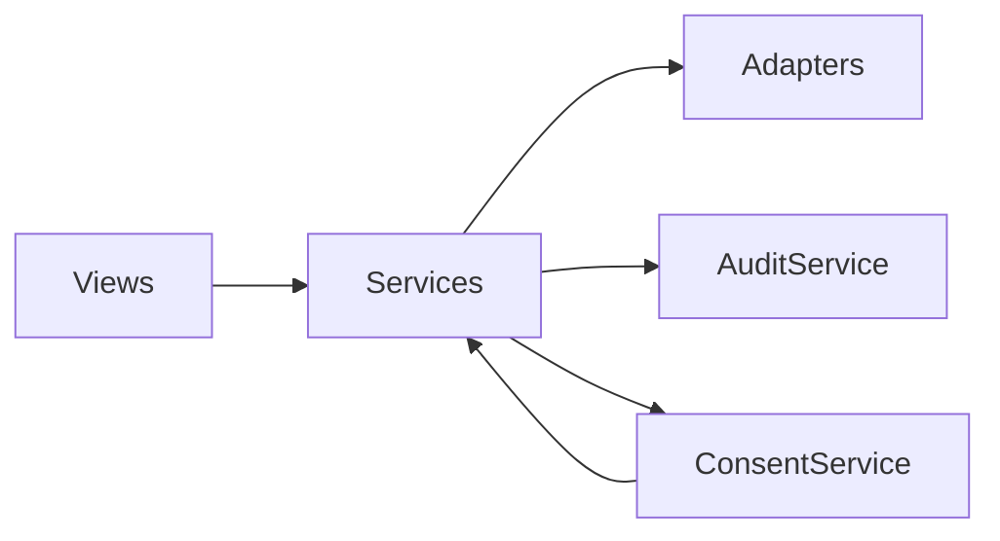
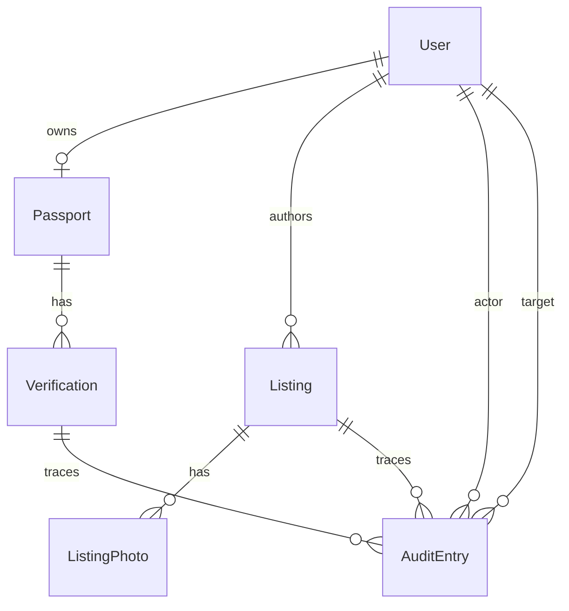
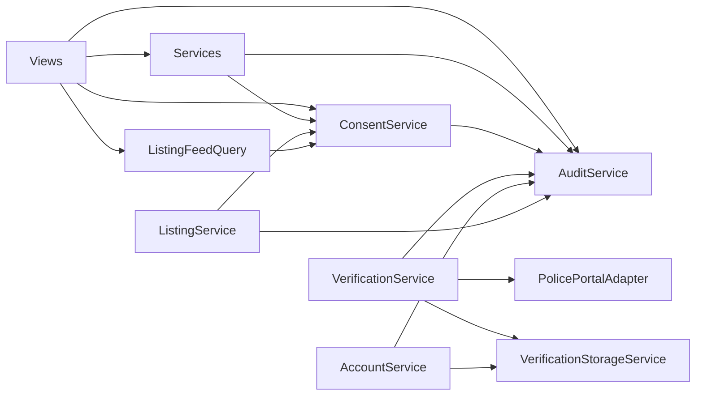

# Architecture Spine — Basha Pass

## Design Paradigm

**Django MTV + HTMX partial-render with a service layer.** Each user-visible action is one URL → one view → one service call → one template response (full page or HTMX partial). Views are thin HTTP adapters that translate request to service call and render the template; services own every business rule and every state mutation. Templates are unified per surface (AD-5).

```
URL → View (HTTP adapter) → Service (business rule + state mutation) → Template (full or HTMX partial)
                                ↓
                       AuditService.append() (same DB transaction)
```

```
services/
  verification/       # AD-2 — passport state machine + verification-status email
  consent/            # AD-3 — what viewer sees of passport
  listing/            # ListingService, archive/cap/edit/withdraw invariants
  account/            # AD-10 — account/session concerns; deletion deferred to v2
  audit/              # AD-15 — append-only audit trail
  storage/            # AD-9 — private PII + public listing-photo media
  feed/               # AD-12 — sole ListingFeedQuery + projection
  adapters/
    police_portal/    # AD-2 — swap-able external mirror
views/                # thin HTTP adapters only — no business logic
templates/
  basha/partials/     # AD-5 — one template path per surface
```

**Dependency direction:** views → services → adapters. Services may call other services (e.g. ListingService calls ConsentService, AuditService). Views never call adapters. Adapters never call services. Templates never call anything (they receive a fully-projected context).



## Invariants & Rules

### AD-1 — Service layer under views

- **Binds:** all
- **Prevents:** two views independently implementing the same business flow with subtly different rules (e.g. one view's listing-create skipping the active-listings cap check, another's not).
- **Rule:** every business-flow mutation goes through a service. Views are thin HTTP adapters: parse request, call one service, render the template. Views never write to a model directly except for read-only projections passed straight to the template.

### AD-2 — VerificationService is the sole mutator of passport state (and sole enforcer of its preconditions)

- **Binds:** FR-3, FR-4, FR-7, FR-8, FR-9, FR-18
- **Prevents:** two callers drifting on what `submitted` / `reviewing` / `verified` / `rejected` mean; views silently skipping the 24h cooldown after rejection; admin/non-admin both being able to call `transition(...)`; admin override racing with external transition; an admin bulk-approve bypassing per-row preconditions; bulk callers looping over `transition(...)` and producing N AuditEntries instead of one bulk AuditEntry; bulk calls timing out on long queues.
- **Rule:** passport state transitions are reachable only via `VerificationService.transition(passport, new_state, *, actor, reason, evidence=None)`. The service — not any view — is the sole enforcer of:
  1. **Role-based authz:** `actor` must be the passport's owner for self-service transitions (`submit`, `resubmit`), an admin for `approve`/`reject`, or the `PolicePortalAdapter` (via the service's `transition_from_external(...)` entrypoint) for portal-driven transitions. The service **rejects** `{actor: non-admin, new_state: 'verified'|'rejected'}` with `{ok: false, code: 'forbidden_role'}`.
  2. **Cooldown enforcement:** any `resubmit` for a passport in `rejected` state checks `now() - last_rejection_at ≥ 24h` inside the service (per FR-9); views never check the cooldown.
  3. **State-machine legality:** transitions only between valid states (`submitted→reviewing`, `reviewing→verified|rejected`, `rejected→submitted` after cooldown). Illegal transitions return `{ok: false, code: 'invalid_transition'}`.
  4. **External-portal invocation:** the service is the sole caller of `PolicePortalAdapter`. Views never call the adapter directly.
- **External entrypoint:** `VerificationService.transition_from_external(passport, external_result)` is called only by the adapter-callback handler and inherits the same precondition checks. No view or CLI calls it directly.
- **Bulk path:** admin bulk-approve (FR-7 `escalate` flow) goes through `VerificationService.transition_bulk(passports, decision, *, actor, reason)` — **one AuditEntry per bulk action with `target_ids`**; never per-row. **Bulk callers MUST call `transition_bulk` — looping over `transition(...)` is forbidden and `transition(...)` rejects calls with `len(passports) > 1` in scope (raises in tests).** `transition_bulk` chunks at **≤500 rows per sub-transaction** with a Postgres `statement_timeout` of 30s; a partial-failure returns `{ok_count, failed_ids: [...], errors: [...]}`.

### AD-3 — ConsentService is the sole owner of "what viewer X sees of passport Y and Listing Z"

- **Binds:** FR-3, FR-4, FR-5, FR-6, FR-11
- **Prevents:** two views leaking NID or contact info to viewers without the verification state to receive them; inconsistent visibility between the feed, the listing detail, and the lister's own listings page; a view bypassing the projection and reading raw model fields.
- **Rule:** every view that displays a passport or a listing calls `ConsentService.render(viewer, passport_or_listing) -> Projection` and renders the projection (not the model). The verification-gated contact-info rule (FR-5) lives in this service: the projection includes the lister's `email` and `phone` only when the viewer's own passport is in `verified` status; otherwise the projection returns `email=None, phone=None` and the listing-detail template renders the locked-contact panel (per FR-11). The projection is the only shape that crosses into templates.
- **No memoization across calls in v1.** Every call re-reads the viewer's current passport state. v1 has no contact-share rows, so there is no shared-state cache key to maintain; this rule is a placeholder for v2 if any consent-driven cache is introduced (the cache key MUST include the viewer's passport `verified` flag and a `projection_version` counter so feed and detail paths cannot disagree).
- **Projection shape is fixed.** `Projection` is a frozen dataclass with a documented field set. Views never construct or mutate it; they only read its fields. The field set is enumerated in the project's `consent/projection.py`.
- **Viewer Protocol.** `ConsentService.render` accepts any `Viewer` (a `typing.Protocol` declared in `consent/viewer.py` requiring only an opaque `viewer_id` and a `kind: Literal['user', 'admin', 'sitemap', 'email_digest']`). Real users, admin actors, and export sentinels all conform. The service's projection rules for each `kind` are enumerated: e.g. `kind='sitemap'` returns PII-redacted output (display_name + verified status only, never area/budget/contact); `kind='email_digest'` returns the same shape as `kind='user'`; `kind='admin'` returns the full admin-view shape (PII visible to admin staff). Future viewer kinds are added by extending the protocol and the projection rule table — never by branching in callers.

### AD-4 — Verification reject reason codes are an enum owned by VerificationService

- **Binds:** FR-8, FR-7
- **Prevents:** reason-code drift across views and admin paths; admin history by-reason-code silently dropping pre-rename rows.
- **Rule:** verification reject reason codes live as a Python `Enum` subclass in `apps/verification/services/reject_reasons.py`. `VerificationService.transition(...)` for the `rejected` state requires the enum member, never a raw string. The enum's `.value` (not `.name`) is the canonical identifier and is what gets stored in `AuditEntry.after_snapshot` (per AD-15). Renaming a member requires a data migration to rewrite existing audit rows.
- **v2 placeholder:** v1 ships no report flow. If v2 reintroduces one (FR-16 / FR-17 per the deferred_to_v2 list), the report-reason enum will be owned by a future `ReportService` and follows the same immutability rule as the verification enum here.

### AD-5 — One template partial per surface, with a fixed context-shape contract

- **Binds:** FR-5, FR-10, FR-11
- **Prevents:** two views producing incompatible markup for the same HTMX swap target (the silent swap-mismatch class of bug); two views including the same partial with different context keys (`passport` vs `author_passport`) and rendering differently at runtime; a feed entry rendered differently when reached from the feed vs. the lister's own "Your listings" page.
- **Rule:** every surface (listing card, passport header, status pill, listing detail body, locked-contact panel, verification banner, cooldown banner, etc.) has exactly one template path under `templates/basha/partials/<surface>.html`. Every view rendering that surface uses Django `` with that fixed name. **The expected context variables are enumerated at the top of each partial file** as a Django comment (e.g. `{# expects: listing_projection, viewer, current_url #}`). A test in `tests/test_partials.py` invokes each partial with its declared context and a sample of caller views; if a caller passes a different key name, the test fails. The shape flowing in is always the relevant service projection (never the raw model). No view-local variant of the surface exists.

### AD-6 — ListingService owns creation, edit, withdraw, and archive invariants

- **Binds:** FR-10, FR-11, FR-12
- **Prevents:** two callers disagreeing on the rent/kind validation (FR-10 — `kind=seat` requires `rent_unit=per_seat`, `kind=room` requires `rent_unit=per_room`); one edit path silently mutating a locked field (`kind`, `area`, `rent_unit`, `rent_period`, `move_in_date` are immutable post-publish); the 3-active-listing cap enforced in one view and bypassed in another; 60-day archive running in a cron that races with a same-day withdraw.
- **Rule:** `ListingService.create(author, *, kind, area, rent_bdt, rent_unit, photos, body, prefs)` is the single entrypoint for creation. The service:
  1. Verifies `author.passport.status == 'verified'` (FR-10).
  2. Validates `kind ∈ {seat, room}`, `rent_unit ∈ {per_seat, per_room}`, `rent_period` is fixed to `per_month` (never user-supplied), and `kind ↔ rent_unit` cross-field constraint.
  3. Enforces `Listing.objects.filter(author=author, archived_at__isnull=True, withdrawn_at__isnull=True).count() < 3`.
  4. Persists the listing, persists photos via `StorageService` (AD-9), and emits one `AuditEntry` recording the create.
  `ListingService.edit(listing, *, fields)` accepts only `rent_bdt`, `body`, and `photos` post-publish — locked fields raise `{ok: false, code: 'field_locked'}`. `ListingService.withdraw(listing, *, actor)` marks `withdrawn_at` and excludes the listing from the feed. `ListingService.archive_stale()` runs daily (management command) and archives listings older than 60 days.
- **Result envelope, never exceptions for expected failures:** the service returns `{ok: bool, value, errors: [{code, message, field?}, ...]}`. Callers (views, the cron, HTMX optimistic-save) translate `ok=False` to form errors, inline errors, or HTMX error fragments. The service never raises for domain-rule violations (`cap_reached`, `field_locked`, `rent_below_floor`, `rent_above_ceiling`, `not_verified`, `archived`); raising is reserved for unexpected exceptions.

### AD-7 — Verification email is sent by VerificationService; no Notification table in v1

- **Binds:** FR-18
- **Prevents:** transactional email racing with the DB transaction that updates passport status; two callers constructing "verification email" bodies and diverging in microcopy; a future Notification service accidentally inheriting v1's email path.
- **Rule:** verification-status email is sent by `VerificationService.transition(...)` as part of the same DB transaction (via Django's `transaction.on_commit` callback). The email body is rendered from a single template per status (`verification/email/verified.html`, `verification/email/rejected.html`). The service accepts an injected `EmailBackend` (Django SMTP in prod, in-memory list in tests) so tests assert on the outbound payload rather than on SMTP. **There is no `Notification` table in v1** — `VerificationService` writes emails directly. If a v2 reintroduces in-app notifications, a future `NotificationService` follows the same `transaction.on_commit` pattern and lives at `services/notification/`; v1 keeps the email path here to avoid splitting email-transport ownership across services.

### AD-8 — Standard Django session auth, LoginRequiredMixin on every authenticated view; admin auth is stock Django admin

- **Binds:** FR-1, FR-20, all authenticated views
- **Prevents:** HTMX partial renders leaking authenticated-only fragments on unauthenticated requests; two views disagreeing on what "logged in" means; an admin logging in via the user-auth path and inadvertently having user privileges; sign-up views being ambiguous about authentication state.
- **Rule:** every authenticated tenant view is a `LoginRequiredMixin` CBV or uses `@login_required` as a FBV decorator. **Sign-up is public**: `accounts/signup/` (email + password) and `accounts/verify-email/` (6-digit token, 5-min expiry, single-use, ≤3 resends per FR-1) are **public views** without `LoginRequiredMixin`. After successful email verification, the session's `is_authenticated` flag flips true and subsequent navigations land on authenticated URLs. Logout (deferred to v2 per the deferred_to_v2 list) invalidates the session immediately when reintroduced.
- **Admin auth (FR-20) is stock Django admin:** the admin panel is `django.contrib.admin` at `/admin/`. Verification review lives in the admin and is performed by Django `is_staff` users created via management command or by another staff user. **Admin login is a separate Django admin URL with separate credentials** — admin users do not share credentials with tenant accounts (the User model is shared but admin users have `is_staff=True` and tenants do not). Verification approve/reject actions run through `VerificationService.transition(...)` (per AD-2) — admin views in `django.contrib.admin` call the service from a custom admin action, never write the model directly.
- **Public-URL allow-list:** the list of public URLs (landing, signup, verify-email, password-reset request, Django admin) lives in one place (`config/urls_public.py`) and is treated as the canonical allow-list. No custom auth middleware in v1.

### AD-9 — PII storage split: private MEDIA_ROOT, VerificationStorageService as sole reader and writer

- **Binds:** FR-3, FR-7
- **Prevents:** NID front/back or selfie becoming URL-accessible by guess; two flows storing PII to the public root; a management command or migration script reading/writing `private/` directly bypassing the auth + audit gates; PII deletion (FR-2 30-day grace) skipping audit.
- **Rule:** Django `MEDIA_ROOT` is split into `private/` (NID, selfie, admin attachments — never URL-accessible) and `public/` (listing photos, avatars — served by `MEDIA_URL`). **`VerificationStorageService` is the sole reader AND writer of `private/`.** Every read or write — by views, by management commands, by data migrations — goes through the service. Retrieval from a view happens via a short-lived signed URL after the service runs auth + permission checks and writes an AuditEntry. No template, view, management command, or migration directly opens a path under `private/`.
- **Deletion (FR-2 30-day grace):** `VerificationStorageService.delete_for_user(user, *, reason)` is called by `AccountService` during the deletion grace window and emits an AuditEntry before any file is unlinked.

### AD-10 — Admin panel is the stock Django admin; admin actions go through services

- **Binds:** FR-7, FR-8, FR-20
- **Prevents:** admin actions drifting from the rules governing everyone else; admin actions bypassing the audit trail; direct ORM writes from `django.contrib.admin` `ModelAdmin.save_model` paths.
- **Rule:** v1 ships no custom admin views. Verification review lives in the stock Django admin, configured by a `PassportAdmin(ModelAdmin)` class registering `apps.verification.models.Passport`. The admin's approve/reject action invokes `VerificationService.transition(passport, new_state, *, actor=admin_user, reason=reason_enum)` (per AD-2) — never writes the Passport model directly. **The admin checks `is_staff` on the user model; tenant users have `is_staff=False` and never see the admin.**
- **Bulk approve in v1 is not used;** if v2 reintroduces bulk review, `VerificationService.transition_bulk(...)` (per AD-2) is the entrypoint, called by a custom admin action, with the same partial-failure envelope.
- **No direct ORM writes from admin paths.** A reviewer reading a PR can confirm `PassportAdmin` overrides call `VerificationService` only, plus audit entry attribution to `request.user`.

### AD-11 — Verification wizard: one LoginRequiredMixin view per step; the router is the sole interpreter of state

- **Binds:** FR-3, FR-9, FR-18
- **Prevents:** two step views disagreeing on what "next" means for a half-complete Verification; an email-link-resume flow that returns to a step the user already completed and bypasses the cooldown check; per-view state-machine logic diverging from the router.
- **Rule:** the wizard has 4 step URLs — `verification/step/nid-front/`, `verification/step/nid-back/`, `verification/step/selfie/`, `verification/step/lifestyle/`. Each is a `LoginRequiredMixin` CBV owning one form and one `VerificationService.transition(...)` (per AD-2). A step-router helper (`verification.step_next_for(user)`) is the **sole interpreter** of "what state is this user's Verification in, and what step should they land on." Step views do NOT inspect passport state themselves; they call the router, render the current step's form, and redirect to the router's next-step URL on success. HTMX is used only within a step (e.g. selfie's preview-and-retake partial). Bookmarks, browser-back, email-link resume, and shared links all resolve to the router's verdict for the current state.
- **Cooldown re-entry:** after a `rejected → resubmit` transition, the router starts the user back at `nid-front` (per FR-3 — every resubmission starts from scratch). The 24h cooldown check is in the service (AD-2), not the view.

### AD-12 — ListingFeedQuery is the sole source of any list of Listings

- **Binds:** FR-10, FR-11, FR-12
- **Prevents:** two callers disagreeing on feed filter semantics, sort order (verified-first then recency), or visibility projection; admin CSV exports / `sitemap.xml` querying `Listing.objects` directly and bypassing visibility rules; one feed page including archived or withdrawn listings (>60 days per FR-12) while another filters them; one feed returning listings for which the viewer's compatibility hint was computed differently than the detail page computes it.
- **Rule:** `ListingFeedQuery.for_viewer(viewer, *, area=None, budget_min=None, budget_max=None, kind=None, rent_unit=None, gender=None, occupation=None, smoking=None, sleep=None, sort='verified_recency', page=1, include_archived=False, include_withdrawn=False)` is the sole callable that returns a list of `Listing` rows for any consumer. Each row in the result has already been through `ConsentService.render(viewer, listing)` so the projection's `email`/`phone` are None for unverified viewers. **Each row carries a precomputed `compatibility_hint: int` (0–6)** computed server-side as `count(viewer.preferences ∩ listing.preferences)` across the 6 lifestyle axes (gender, smoking, sleep, occupation, area, rent). The hint is an integer in 0–6; templates render `"matches {hint} of 6 preferences"` per FR-11 and color the hint via `success-fg` when `hint ≥ 4` and `text-muted` otherwise. **No percentage, no star rating, no algorithmic ranking** is ever produced or stored.
- **Caller surfaces:** feed views (default feed, filter-applied feed via HTMX), listing detail "similar listings" panel, "Your listings" page (filtered by `author=viewer`, supports `include_archived=True`), Django admin "browse as user" preview, and `sitemap.xml` all call only this query.
- **Viewer sentinels for non-user callers:** exports and `sitemap.xml` pass an explicit viewer sentinel (e.g. `SitemapViewer` — never-a-real-user; projection returns `is_listed=True` but PII-redacted and `compatibility_hint=None`). This keeps the projection logic in one place. No view, export, or admin tool runs its own ORM query for a listing list.
- **Archived / withdrawn filter:** `include_archived` and `include_withdrawn` default to `False` (FR-12). The author's own "Your listings" page passes `include_archived=True` when the user has toggled "Show archived" on; `include_withdrawn` is always `False` for any caller (a withdrawn listing is gone from every view).

### AD-13 — Locale handling + optimistic-save contract

- **Binds:** FR-4, FR-6, all forms taking user-typed text
- **Prevents:** Bengali script being lost on optimistic-save failure; locale handling drifting across forms; one view returning a partial fragment that strips user-typed content; the optimistic-save error fragment re-rendering the form with `form.field.value` (which returns the model's prior value on invalid) instead of the user's just-typed Bengali input.
- **Rule:** `LocaleFormMixin` (a Django form mixin applied to every form taking user-typed text) sets the widget's `lang` attr placeholder, ensures the field's container carries `lang="bn"` when the content is Bengali, and pins the font stack to include `"Noto Sans Bengali", "SolaimanLipi", sans-serif`. **The HTMX optimistic-save contract is normative:** any view supporting optimistic saves returns the partial fragment on success AND, on form-invalid failure, an error-state fragment in which each field's `value` attribute is **`request.POST.get(field_name)`** — explicitly NOT `form.field.value()` (which returns the model's prior value when the form has been re-bound). A `tests/test_optimistic_saves.py` test verifies this for every form using the mixin.
- **Locale markup at the partial layer:** templates holding the user's just-typed Bengali must carry `lang="bn"` on the immediate container; `LocaleFormMixin` exposes a `` template tag for this. Forms inheriting `LocaleFormMixin` are the only forms that take user-typed text.

### AD-15 — AuditService is the sole writer of the append-only AuditEntry table; snapshots survive migrations

- **Binds:** all state-mutating services; FR-2 (when reintroduced) account-deletion audit trail
- **Prevents:** skipped audit entries on safety-relevant state changes; the admin's reasoning panel showing a gap in history; an incident reconstruction that misses what happened; **`AuditEntry.after_snapshot` JSON fields rendering empty 3 months after a `RenameField` migration**.
- **Rule:** `AuditService.append(*, actor, action_kind, target, before_snapshot, after_snapshot, reason, snapshot_schema_version)` is the sole callable that writes an `AuditEntry`. Every state-mutating service (`VerificationService`, `ListingService`, `AccountService`) calls `AuditService.append(...)` **in the same DB transaction** as the mutation. The `AuditEntry` table is append-only — no UPDATE or DELETE in any service path. Django admin's built-in `LogEntry` is the complementary audit stream for admin-side model edits (it captures which admin did what in the Django admin UI); the AuditEntry table is the source of truth for service-driven mutations.
- **Snapshot migration safety:** `after_snapshot` and `before_snapshot` are JSONFields. Each entry stores `snapshot_schema_version: str` formatted as `<app_label>.<model_name>@v<n>` — for example `verification.Passport@v3`. The angle-bracket format is the literal wire form (no Python f-string at the doc layer; the implementer chooses the formatting call site). The version is keyed per snapshotted model — **not globally** — so two different models can evolve their snapshot schemas independently without bumping each other's versions. **Any schema change to a snapshotted model (rename column, change field shape, change enum member names) MUST ship a data-migration companion that rewrites existing `AuditEntry` rows to the new field names AND increments the version.** A reader-side renderer dispatches on `(app_label, model_name, version)`; old versions stay readable while new versions are written.
- **CI enforcement (governance):** a CI hook (a pre-commit + a `manage.py audit_safety_check` command) fails the build when (a) a schema migration touches a model listed in `apps.audit.SNAPSHOTTED_MODELS` without a corresponding data migration in the same PR, or (b) an `Enum` member is renamed in a service module without a matching audit-rewrite migration. The hook is configured in `.pre-commit-config.yaml` and `pyproject.toml` and runs in CI on every PR.
- **Enum identifier discipline:** reason codes and other enums are stored in audit JSON using the enum's `.value` (not `.name`), per AD-4.

## Consistency Conventions

| Concern | Convention |
| --- | --- |
| **Service naming** | `VerbService` or `NounService`; file path under `apps/<domain>/services/<name>.py`. No service under `views/`. |
| **View naming** | Django URL-conf name (e.g. `verification_step_nid_front`); file under `apps/<domain>/views/<name>.py`. Each view is a CBV subclassing `LoginRequiredMixin` unless explicitly public. |
| **Template naming** | snake_case under `templates/basha/<surface>.html` for full pages; `templates/basha/partials/<surface>.html` for partials (AD-5). |
| **Service return shape** | Services return either a domain object (e.g. a refreshed Passport) or a result envelope (`{ok: bool, value, errors: [...]}`); never raise for expected business-rule failures. Views translate `ok=False` to form errors or HTMX error fragments. |
| **Form naming** | `<Domain><Action>Form` (e.g. `VerificationNidFrontForm`). Any form taking user-typed text inherits `LocaleFormMixin` (AD-13). |
| **IDs** | UUIDv7 for all domain entity PKs (time-sortable, prevents enumeration). Slug IDs not used. |
| **Timestamps** | `created_at` / `updated_at` on every mutable model; `TIMESTAMPTZ` in PostgreSQL; UTC at rest, local at the edge (Asia/Dhaka). |
| **Error envelope (API-style, partials)** | `{ok: false, code: '<machine_code>', message: '<user-facing>', field_errors: {<field>: [<msg>]}}` — never raise for user-facing errors. |
| **Money** | BDT only; stored as `Listing.rent_bdt: PositiveIntegerField` (integer taka in the range ৳500–৳50,000). No paisa, no decimals, no fractional values. The model field is named `rent_bdt` to make the unit self-documenting; the rent `period` is a separate field (`Listing.rent_period` with a `choices=[(per_month, 'Per month')]` value, but constrained to `per_month` in v1 — see AD-6 and FR-10). Render with `৳` prefix and a `money_bdt` template filter that takes the integer and emits `৳{value}`. Form inputs use `type="number"` with `step="1"`. |
| **Reasons / enums** | All reason codes (report reasons, reject reasons, suspend reasons, ban reasons) live as Python `Enum` subclasses in their owning service. The service is the canonical source. |
| **Auth check** | `LoginRequiredMixin` on every CBV that needs it; `@login_required` on every FBV. No custom auth middleware. Public URLs in `urls_public.py`; authenticated URLs in `urls_authed.py`. |
| **Logging** | Every service emits a structured log line (`logger.info(...)` with `actor`, `action`, `target`, `result`). Audit is the immutable write; log is the searchable stream. |
| **Config** | `django-environ` reads `.env`. Secrets never in source. `DATABASE_URL` style. Settings split: `base.py`, `dev.py`, `prod.py`, `test.py`. |

## Stack

| Name | Version | Notes |
| --- | --- | --- |
| Python | 3.12+ | Required for Django 5.2. |
| Django | 5.2 LTS | Apr 2025 LTS, supported until Apr 2028 — long support window suits v1 single-server deployment. Pin exact patch at scaffolding. |
| PostgreSQL | 17 | Sep 2024 stable. SQL/JSON + logical replication available for admin-queue scale-out (PRD OQ-6 unresolved). Pin exact patch at scaffolding. |
| HTMX | 2.0.x | Partial-render protocol the paradigm depends on. Pin exact patch at scaffolding; web search was offline this session — confirm current minor at install time. |
| `psycopg` (3.x) | pin at scaffolding | PostgreSQL driver. |
| `django-environ` | pin at scaffolding | `.env` reading + URL-style config. |

**Seed, code owns once it exists.** Patch versions marked `pin at scaffolding` because web search was unavailable during authoring — the implementer picks the exact patch at install time and locks it in `requirements.txt`.

## Structural Seed

### Source tree

```
rent/
  manage.py
  pyproject.toml                # or requirements.txt — implementer's choice
  .env.example
  config/
    settings/
      base.py
      dev.py
      prod.py
      test.py
    urls_public.py             # AD-8 public allow-list
    urls_authed.py
  apps/
    accounts/                   # User model, AccountService (AD-10), LoginRequiredMixin CBVs, OTP views
    verification/               # VerificationService (AD-2), step-router, VerificationStorageService (AD-9), wizard views (AD-11), PolicePortalAdapter (AD-2), reject-reason enum (collapsed AD-4)
    passports/                  # Passport model, ConsentService (AD-3), tiered-freeze rules
    listings/                   # Listing + ListingPhoto models, ListingService (AD-6), ListingFeedQuery (AD-12), feed + detail views, listing create/edit/withdraw views
    audit/                      # AuditEntry model, AuditService (AD-15)
  templates/
    base.html
    basha/
      landing.html
      partials/
        listing_card.html       # AD-5 — sole template path for listing-card surface
        passport_header.html    # AD-5
        status_pill.html        # AD-5
        cooldown_banner.html    # AD-5
  static/
    css/tokens.css              # DESIGN.md CSS custom properties
    css/app.css
    js/htmx.min.js              # AD-1 — HTMX partial-render runtime
  media_private/                # AD-9 — NID, selfie, admin attachments (never URL-accessible)
  media_public/                 # AD-9 — listing photos, avatars (served via MEDIA_URL)
```

### Core-entity ERD



Names + relationships only. Field-level details (status enums, timestamps, tiered-freeze columns) are not in the spine — the implementer owns them.

### Service dependency graph



Reads top-down: views call services. Services audit; emails are sent directly by VerificationService (AD-7). ConsentService and AuditService are the most-called nodes — they're the load-bearing read services. ListingService owns the invariants around listing creation, edit, withdraw, and auto-archive (AD-6).

## Capability → Architecture Map

| Capability / Area | Lives in | Governed by |
| --- | --- | --- |
| FR-1 — Sign-up + 6-digit email token (5-min expiry, password policy) | `apps/accounts/` | AD-8 |
| FR-2 — Logout + 30-day account-deletion grace | `apps/accounts/` | AD-8, AD-10 (AccountService) |
| FR-3 — Passport creation (NID + selfie + lifestyle; immutable post-verify) | `apps/passports/`, `apps/verification/` | AD-2, AD-3, AD-9, AD-11 |
| FR-4 — Lifestyle profile (6 fields, dynamic budget slider, 13 Dhaka areas) | `apps/passports/` | AD-3, AD-13 |
| FR-5 — Passport visibility to others (no NID/email; contact info verification-gated) | `apps/passports/` ConsentService | AD-3 |
| FR-6 — Display name (3–32 chars; changeable post-verify w/ audit) | `apps/passports/` | AD-3 (write side), AD-15 (audit) |
| FR-7 — Admin verification queue (FIFO + escalate) | stock Django admin on `apps/verification/` | AD-2, AD-10 |
| FR-8 — Reject reason codes (5 enum members) | `apps/verification/` | AD-4 (enum lives in VerificationService; AuditEntry stores enum value, not name) |
| FR-9 — 24h re-submission cooldown (server-enforced) | `apps/verification/` | AD-2 (cooldown enforced in service, not view) |
| FR-10 — Listing creation (verified-only; kind=seat/room; 1–7 photos; ≤500-char body) | `apps/listings/` | AD-1, AD-2 (verified check), AD-6 (ListingService.create) |
| FR-11 — Feed display + 8-axis filtering (area, budget, gender, occupation, move-in, kind, unit, duration) + compatibility_hint | `apps/listings/` | AD-5, AD-12 (ListingFeedQuery) |
| FR-12 — Active listing limit (≤3 active; 60-day auto-archive) | `apps/listings/` | AD-6 (ListingService.create enforces active limit; ListingService.archive_due enforces 60-day expiry) |
| FR-18 — Verification-status email (≤5 min; reason code human-readable) | `apps/verification/` | AD-2 (transition emits), AD-7 (VerificationService sends email directly) |
| FR-20 — Admin authentication | stock Django admin (`django.contrib.admin`) | AD-8 (separate `is_staff` superuser; no custom middleware) |
| Optimistic-UI for passport-field edits (NID/phone) | `apps/passports/` + HTMX views | AD-5, AD-13 |
| Audit trail (every state-mutating service) | `apps/audit/` | AD-15 |

## Deferred

- **Email delivery provider for OTP** — needed before OTP flow ships. Candidates: Postmark (cleanest Django integration), Resend (modern, dev-friendly), SES (cheapest at scale). Defer to scaffolding. (PRD silent; flagged in memlog.)
- **Media storage backend** — AD-9 names the public/private split; v1 single-server can use `FileSystemStorage`; v2 may move to `django-storages` + S3-compatible. Backend-agnostic for now.
- **Rate-limiting** — needed for OTP, contact-share, report endpoints. Defer to a dedicated AD once a library choice is made (django-ratelimit is the obvious default; could become AD-16).
- **CSRF strategy for HTMX partials** — Django's CSRF + HTMX header requires a small token-in-header middleware. Decide once a partial-render implementation lands. Could become AD-17.
- **Static asset hosting** — single-server v1 uses `django.contrib.staticfiles`; deferred CDN choice for v2.
- **Background job runner** — verification emails, listing auto-archive, and OTP rate-limiting may eventually want a queue. v1 can stay synchronous inside the request transaction (per AD-6 / AD-7). If volume grows, swap to Celery / django-q2. Defer.
- **i18n / multi-locale UI** — Bengali input supported (AD-13); Bengali UI chrome deferred per PRD.
- **PRD open questions that are out of spine scope:**
  - OQ-6 — admin queue >50 scale-up process (no scale-up process yet; revisit at growth).
  - OQ-7 — display-name moderation (manual vs. blocklist) — out of architecture scope; policy.
  - OQ-11 — email-reality for Anika persona (UX question; defer until persona research).
- **Operational envelope** (deployment, infra, ops) — explicitly **out of spine scope at feature altitude**. Reopened at initiative altitude if Basha Pass grows beyond v1. v1 single-server deployment is assumed; concrete deployment topology belongs in a separate ops doc once it's chosen.
- **Django admin scope** — stock `django.contrib.admin` is the **sole admin surface** for v1 (AD-10): verification queue (FIFO + escalate), reject with reason code, and any other state-mutating admin action live there. No separate admin-login URL, no custom admin app. Implementer wires `ModelAdmin` classes for `Verification`, `Listing`, `Passport`, `User` at scaffolding.
