# ER Diagram — Basha Pass v1

This document extends the **Core-entity ERD** already present in `ARCHITECTURE-SPINE.md` §Structural Seed with **per-context attribute-level schemas** and an explicit **context map**. The spine's ERD names entities and relationships; this file enumerates the columns, enums, indexes, and FK constraints that the implementer owns.

Every entity below is **warranted by an FR or AD in the PRD/Spine**. Anything not warranted by an FR/AD is **omitted** — including the deferred-to-v2 surface area (see "Explicitly absent in v1" at the bottom).

## Notation

- **Type syntax** — column types use a PostgreSQL-flavored pseudo-DDL (e.g. `UUIDv7`, `text`, `text_array`, `JSONB`, `TIMESTAMPTZ`, `PositiveInteger`). Mermaid `erDiagram` does not have native support for these types, so they are written as plain identifiers; the **authoritative** column type lives in the row above the diagram block (and in the Django migration). Where a CHECK is shown, the constraint lives at the DB layer, not the model layer.
- **Primary key** — every entity uses `UUIDv7` as its primary key (time-ordered, generated client-side). See ADR-? for the rationale.
- **Foreign keys** — written as `<table>.id`. The ON DELETE action is stated per FK (see "CASCADE vs RESTRICT" below for the rationale per relationship).
- **Polymorphic FKs** — `AuditEntry.target_id` is deliberately **not** a hard FK; it points to `<app_label>.<model_name>::target_id`. This keeps Audit append-only across renames and migrations of the targeted model.
- **Snapshot versioning** — every snapshotted table carries `snapshot_schema_version` (`<app_label>.<model_name>@v<n>` per AD-15). The audit renderer dispatches on this version.

## Context Map

Basha Pass v1 contains five bounded contexts, each owning its entities and owning exactly one service (per the spine's AD-1 service-layer rule):

```
┌─────────────────────────┐    ┌──────────────────────────┐
│ 1. Identity             │    │ 2. Verification          │
│    User                 │───▶│    Verification          │
│    AccountService (AD-8)│    │    VerificationService   │
└─────────────────────────┘    │    (AD-2, AD-11)         │
            │                 └──────────────────────────┘
            ▼
┌─────────────────────────┐    ┌──────────────────────────┐
│ 3. Passport             │◀──▶│ 4. Listing               │
│    Passport             │    │    Listing               │
│    LifestyleProfile     │    │    ListingPhoto          │
│    ConsentService (AD-3)│    │    ListingService (AD-6) │
└─────────────────────────┘    │    ListingFeedQuery      │
                                │    (AD-12)              │
                                └──────────────────────────┘
                                            │
                                            ▼
                            ┌──────────────────────────┐
                            │ 5. Audit (cross-cutting) │
                            │    AuditEntry            │
                            │    AuditService (AD-15)  │
                            └──────────────────────────┘
```

Cross-context dependencies: Identity is the kernel; Verification requires Identity (a passport must belong to a user); Passport requires Identity and produces the state that gates Listing creation; Listing produces ListingPhoto children. **Audit is the only context that may FK into every other context** (it captures actor + target across services) and it does so without back-references from the audited contexts.

---

## 1. Identity Context

Owned by `apps/accounts/`. Governed by AD-8 (auth) and AD-10 (admin surface).

### Entities

#### User

The single user table for both tenant and admin actors. Admin-ness is a flag, not a separate model (per AD-8: stock Django auth + `is_staff`).

| Attribute | Type | Notes |
|---|---|---|
| `id` | UUIDv7 (PK) | Per Consistency Conventions; time-sortable, prevents enumeration |
| `email` | `CITEXT UNIQUE NOT NULL` | Same email cannot create multiple accounts (FR-1); case-insensitive uniqueness |
| `password_hash` | `text NOT NULL` | Argon2id or Django's default PBKDF2; never stored reversible |
| `is_staff` | `boolean NOT NULL DEFAULT false` | Tenant users have `is_staff=False`; admins `True` (AD-8) |
| `is_active` | `boolean NOT NULL DEFAULT true` | Toggled to false on account deletion grace expiry (FR-2, deferred per `deferred_to_v2` in spine) |
| `date_joined` | `TIMESTAMPTZ NOT NULL DEFAULT now()` | UTC at rest |
| `last_login` | `TIMESTAMPTZ NULL` | Django auth convention |
| `created_at` | `TIMESTAMPTZ NOT NULL` | Per Consistency Conventions |
| `updated_at` | `TIMESTAMPTZ NOT NULL` | Per Consistency Conventions |

Indexes: `UNIQUE(email)` (case-insensitive).

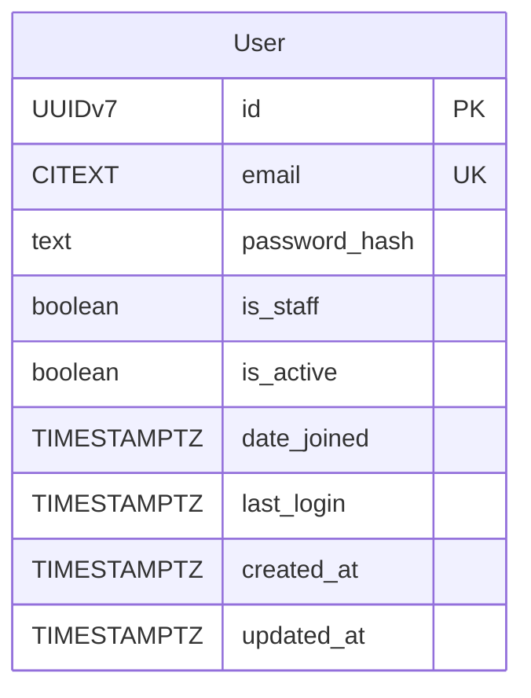

#### EmailVerificationToken

The 6-digit OTP issued at signup (FR-1). The spine's `deferred_to_v2` does NOT include email verification; this is in scope for v1.

| Attribute | Type | Notes |
|---|---|---|
| `id` | UUIDv7 (PK) | |
| `user_id` | UUIDv7 (FK → User.id, ON DELETE CASCADE) | |
| `token_hash` | `text NOT NULL` | Store hash, not raw token; raw token only ever in email body |
| `created_at` | `TIMESTAMPTZ NOT NULL DEFAULT now()` | Used to enforce 5-min expiry |
| `expires_at` | `TIMESTAMPTZ NOT NULL` | `created_at + interval '5 minutes'` (RESOLVED) |
| `consumed_at` | `TIMESTAMPTZ NULL` | Set on successful use; single-use (RESOLVED) |
| `resend_count` | `smallint NOT NULL DEFAULT 0` | Cap at 3 per signup attempt (RESOLVED) |

Indexes: `(user_id, created_at DESC)`, `UNIQUE(token_hash)`.

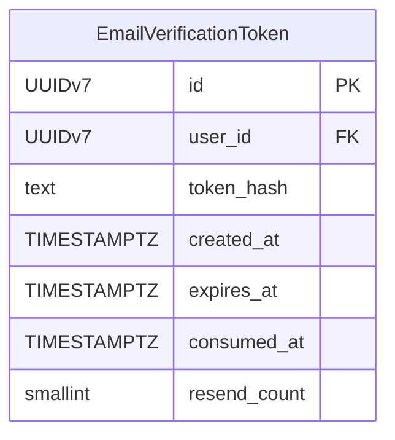

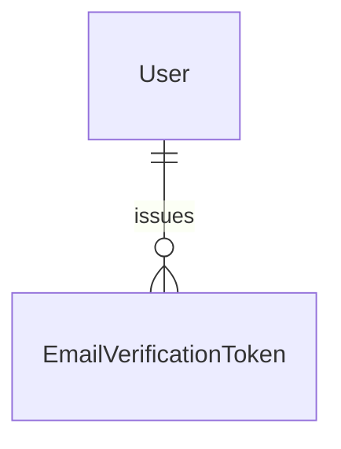

---

## 2. Verification Context

Owned by `apps/verification/`. Governed by AD-2 (sole mutator), AD-4 (reject-reason enum), AD-7 (no Notification table), AD-11 (wizard router), AD-9 (PII storage).

### Entities

#### Verification

Represents one verification *attempt* for a passport. A rejected passport followed by a resubmission creates a **new** Verification row (per FR-3: every resubmission starts from scratch; reuse of prior NID photos NOT permitted).

| Attribute | Type | Notes |
|---|---|---|
| `id` | UUIDv7 (PK) | |
| `passport_id` | UUIDv7 (FK → Passport.id, ON DELETE CASCADE) | |
| `state` | `text NOT NULL CHECK (state IN ('submitted','reviewing','verified','rejected'))` | AD-2 state machine. `'submitted' → 'reviewing'` happens when the admin opens the submission in the queue (DFD Context 2, process 2.4). `'reviewing'` is admin-internal and never projected publicly. |
| `nid_front_path` | `text NULL` | Relative path under `media_private/` (AD-9). One set of paths per attempt — required for FR-3 fresh-photo rule. |
| `nid_back_path` | `text NULL` | Same |
| `selfie_path` | `text NULL` | Same |
| `submitted_at` | `TIMESTAMPTZ NOT NULL` | Used for FIFO queue ordering (FR-7) |
| `last_rejection_at` | `TIMESTAMPTZ NULL` | Used for 24h cooldown (FR-9, AD-2) |
| `reject_reason` | `text NULL CHECK (reject_reason IN ('expired','mismatch','illegible','tampering_suspected','other'))` | AD-4 enum (5 members); stored as enum `.value` not `.name` |
| `reviewed_by_id` | UUIDv7 (FK → User.id, ON DELETE SET NULL) NULL | Admin actor; NULL while in `submitted`/`reviewing` |
| `reviewed_at` | `TIMESTAMPTZ NULL` | Set when terminal state (`verified`/`rejected`) reached |
| `snapshot_schema_version` | `text NOT NULL DEFAULT 'verification.Verification@v1'` | AD-15; per-model version for audit-read safety |
| `created_at` | `TIMESTAMPTZ NOT NULL` | |
| `updated_at` | `TIMESTAMPTZ NOT NULL` | |

Indexes: `(state, submitted_at)` for FIFO query (FR-7), `(passport_id, state)` for cooldown lookup.

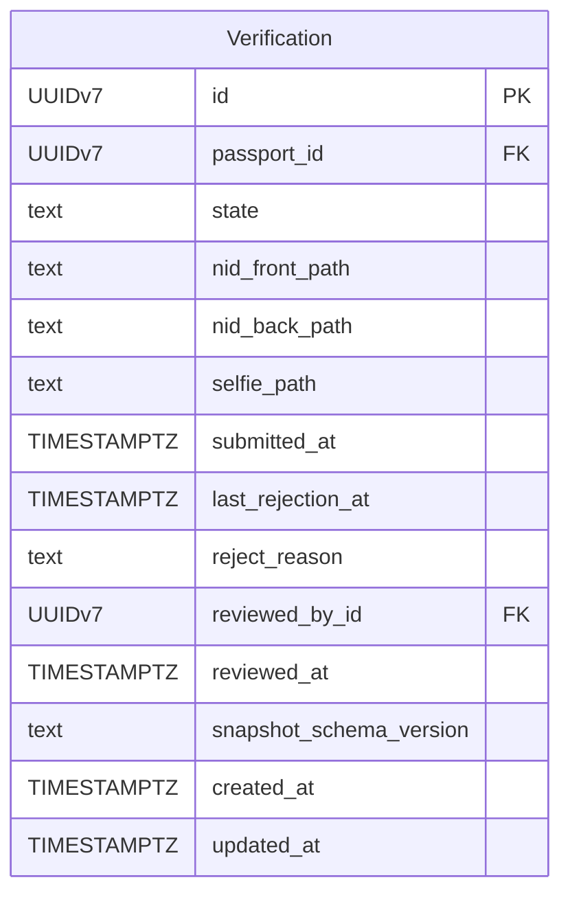

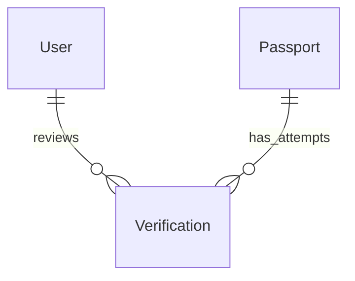

**Why state is on Verification, not on Passport.** PRD §4.3 says "passport status" colloquially; the spine's AD-2 model makes Verification the stateful row because re-submission creates a fresh attempt. The Passport carries a *current_state* denormalization (read projection) but the legal state lives here. See also AD-15's snapshot-schema rule — `verification.Verification` is one of the snapshotted models.

**NID / selfie photo paths live on Verification, not on Passport.** A rejected passport followed by a resubmission (FR-3) must use *fresh* photos — the previous attempt's images must not be re-presented to the admin. Storing the paths on Passport (as a single set per user) would overwrite earlier paths and make attempt-level audit impossible. Storing them on Verification (one set per attempt) lets the admin queue join `verification.id → media_private/<path>` for the attempt under review, and lets the audit trail record which images were seen at which decision.

---

## 3. Passport Context

Owned by `apps/passports/`. Governed by AD-3 (ConsentService is sole projection owner), AD-9 (PII split), AD-13 (locale + optimistic save).

### Entities

#### Passport

The Tenant Passport object — one per user. Holds the **current state** (denormalized from latest Verification row for read-path efficiency) and the lifestyle profile.

| Attribute | Type | Notes |
|---|---|---|
| `id` | UUIDv7 (PK) | |
| `user_id` | UUIDv7 (FK → User.id, ON DELETE CASCADE) UNIQUE | One passport per tenant (PRD Glossary) |
| `display_name` | `text NOT NULL CHECK (char_length(display_name) BETWEEN 3 AND 32)` | FR-6 RESOLVED bounds |
| `current_state` | `text NOT NULL CHECK (current_state IN ('draft','submitted','verified','rejected'))` | Denormalized from latest Verification; AD-3 projection source. Does **not** include `'reviewing'` — that is admin-internal to `Verification.state` and is not projected publicly. |
| `verified_at` | `TIMESTAMPTZ NULL` | Stamped exactly once, by `VerificationService.transition` in the same DB transaction that flips `Verification.state → 'verified'` (DFD Context 2, process 2.3). |
| `verified_fields_frozen` | `boolean NOT NULL DEFAULT false` | Flipped `true` in the same transaction as `verified_at` (FR-3 immutability). Once true, `display_name` is the only Passport field the tenant may change, and only via the audited display-name path. |
| `snapshot_schema_version` | `text NOT NULL DEFAULT 'passports.Passport@v1'` | AD-15 version stamp. Incremented when a new column is added or renamed; readers (e.g. AuditEntry snapshot renderer) dispatch on this version. |
| `created_at` | `TIMESTAMPTZ NOT NULL` | |
| `updated_at` | `TIMESTAMPTZ NOT NULL` | |

**Note (photo storage):** NID and selfie paths are **not** stored on Passport. They live on `Verification` (one set per attempt). See "Why state is on Verification" above and DFD Context 2.

Indexes: `UNIQUE(user_id)`, `(current_state)` for feed-side verification gate (FR-11).

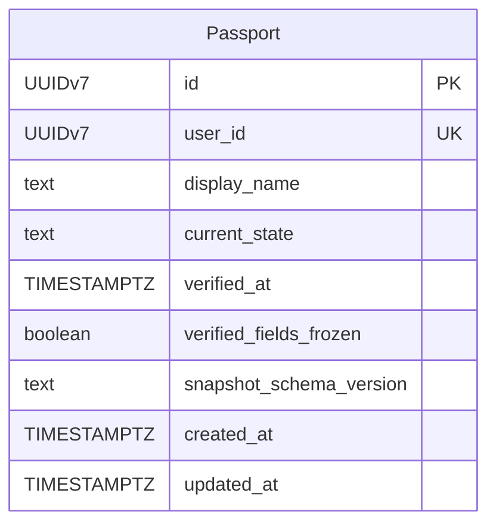

#### LifestyleProfile

Six-field profile (FR-4). One-to-one with Passport — the columns live here rather than on Passport to keep the PII/media paths separate from the lifestyle data, and to match the spine's app-boundary (`apps/passports/`).

| Attribute | Type | Notes |
|---|---|---|
| `id` | UUIDv7 (PK) | |
| `passport_id` | UUIDv7 (FK → Passport.id, ON DELETE CASCADE) UNIQUE | |
| `gender` | `text NOT NULL CHECK (gender IN ('male','female','other'))` | FR-4 RESOLVED |
| `occupation` | `text NOT NULL CHECK (occupation IN ('student','garments_worker','private_job','freelancer','other'))` | FR-4 RESOLVED |
| `smoking` | `text NOT NULL CHECK (smoking IN ('yes','no','occasionally'))` | FR-4 RESOLVED |
| `sleep_schedule` | `text NOT NULL CHECK (sleep_schedule IN ('early_bird','night_owl','flexible'))` | FR-4 RESOLVED |
| `area_preferences` | `text[] NOT NULL` | Multi-select from 13 canonical Dhaka sub-areas (FR-4 RESOLVED) |
| `budget_min_bdt` | `PositiveIntegerField NOT NULL CHECK (budget_min_bdt >= 500)` | FR-4; integer BDT only (Consistency Conventions) |
| `budget_max_bdt` | `PositiveIntegerField NOT NULL CHECK (budget_max_bdt <= 50000 AND budget_max_bdt >= budget_min_bdt)` | FR-4 RESOLVED upper bound |
| `updated_at` | `TIMESTAMPTZ NOT NULL` | |

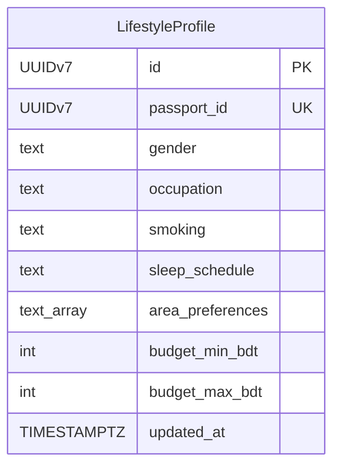

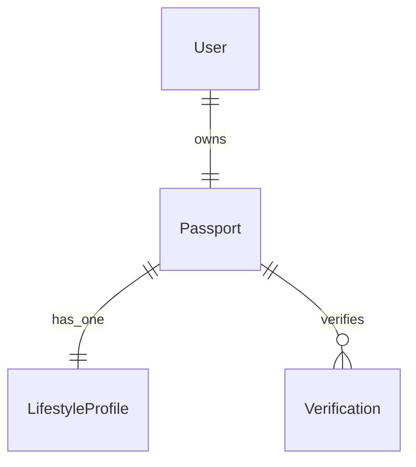

---

## 4. Listing Context

Owned by `apps/listings/`. Governed by AD-5 (one partial per surface), AD-6 (ListingService invariants), AD-12 (ListingFeedQuery is sole source of listing lists).

### Entities

#### Listing

Supply-side post. Created only by verified tenants (FR-10). Soft-archived at 60 days, soft-withdrawn manually; never hard-deleted (FR-12).

| Attribute | Type | Notes |
|---|---|---|
| `id` | UUIDv7 (PK) | |
| `author_id` | UUIDv7 (FK → Passport.id, ON DELETE RESTRICT) NOT NULL | Listing belongs to the *passport*, not raw User (AD-3); restrict because deleters must withdraw first |
| `kind` | `text NOT NULL CHECK (kind IN ('seat','room'))` | FR-10 |
| `rent_bdt` | `PositiveInteger NOT NULL CHECK (rent_bdt BETWEEN 500 AND 50000)` | FR-10; rent unit prefix |
| `rent_unit` | `text NOT NULL CHECK (rent_unit IN ('per_seat','per_room'))` | FR-10; cross-field constraint with kind (AD-6) |
| `rent_period` | `text NOT NULL DEFAULT 'per_month' CHECK (rent_period = 'per_month')` | FR-10; system-fixed in v1, never user-supplied (AD-6) |
| `area` | `text[] NOT NULL CHECK (cardinality(area) BETWEEN 1 AND 13 AND area <@ ARRAY[<13 canonical Dhaka sub-areas>])` | Multi-select from the same 13 canonical Dhaka sub-areas used by `LifestyleProfile.area_preferences` (FR-10/FR-4). The full enum list is the same set referenced in the LifestyleProfile CHECK; do not duplicate the list here — see the source-of-truth comment in the migration. |
| `body` | `text NULL CHECK (body IS NULL OR char_length(body) <= 500)` | FR-10 |
| `pref_gender` | `text NOT NULL CHECK (pref_gender IN ('male','female','any'))` | FR-10 |
| `pref_smoking` | `text NOT NULL CHECK (pref_smoking IN ('yes','no','any'))` | FR-10 |
| `pref_sleep` | `text NOT NULL CHECK (pref_sleep IN ('early_bird','night_owl','flexible'))` | FR-10 |
| `pref_occupation` | `text[] NOT NULL` | Multi-select; `'any'` is a sentinel included in the array |
| `snapshot_schema_version` | `text NOT NULL DEFAULT 'listings.Listing@v1'` | AD-15 version stamp (same convention as Verification and Passport) |
| `created_at` | `TIMESTAMPTZ NOT NULL` | FR-11 sort key (verified-recency: verified first, then this) |
| `archived_at` | `TIMESTAMPTZ NULL` | FR-12; archive_stale cron sets this at age > 60 days |
| `withdrawn_at` | `TIMESTAMPTZ NULL` | AD-6 manual withdrawal |

Indexes: `(author_id, archived_at, withdrawn_at)` for active-cap check (AD-6), `(created_at DESC)` for feed sort, `(archived_at)` partial-index WHERE `archived_at IS NULL` for active filter.

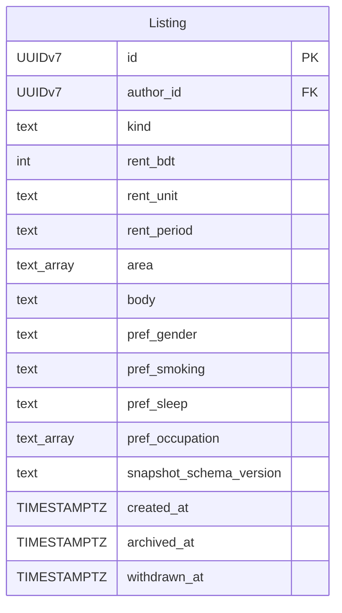

#### ListingPhoto

Children of a Listing. 1–7 photos per Listing (FR-10). Stored in `media_public/`, served via `MEDIA_URL` (AD-9 split).

| Attribute | Type | Notes |
|---|---|---|
| `id` | UUIDv7 (PK) | |
| `listing_id` | UUIDv7 (FK → Listing.id, ON DELETE CASCADE) NOT NULL | |
| `storage_path` | `text NOT NULL` | Path under `media_public/listings/` |
| `position` | `smallint NOT NULL CHECK (position BETWEEN 1 AND 7)` | FR-10 cap |
| `byte_size` | `int NOT NULL CHECK (byte_size <= 5*1024*1024)` | FR-10 5MB cap |
| `content_type` | `text NOT NULL CHECK (content_type IN ('image/jpeg','image/png','image/webp'))` | FR-10 |
| `created_at` | `TIMESTAMPTZ NOT NULL` | |

Indexes: `(listing_id, position)` UNIQUE.

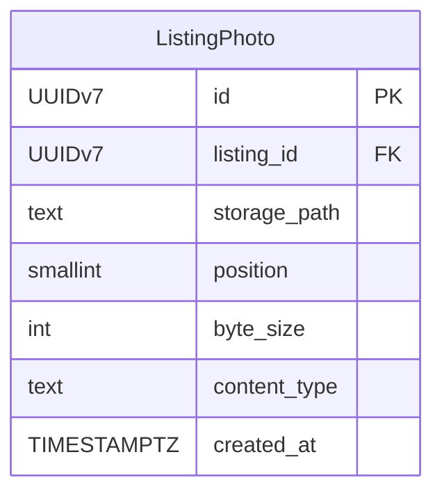


**Why no `LookingFor` entity.** Despite the PRD journey text referring to "Looking For" posts, the spine's binding list and PRD §4.4 are explicit: *"v1 ships one Listing kind: Listing — no separate 'Looking For' demand-side post."* The matching surface is a filtered view of Listings, not a parallel entity.

---

## 5. Audit Context (cross-cutting)

Owned by `apps/audit/`. Governed by AD-15 (append-only, schema-versioned snapshots). **Audit is the only context that may FK into every other context** — but no other context FKs back.

### Entities

#### AuditEntry

Append-only audit row. One per service-driven state mutation. Per AD-15: snapshots are JSONFields, versioned per model.

| Attribute | Type | Notes |
|---|---|---|
| `id` | UUIDv7 (PK) | |
| `actor_id` | UUIDv7 (FK → User.id, ON DELETE RESTRICT) NOT NULL | The acting user (tenant self-service or admin) |
| `action_kind` | `text NOT NULL` | e.g. `verification.submit`, `verification.approve`, `verification.reject`, `listing.create`, `listing.edit`, `listing.withdraw`, `listing.archive_stale`, `display_name.change` |
| `target_type` | `text NOT NULL` | `<app_label>.<model_name>` e.g. `verification.Verification` |
| `target_id` | `UUIDv7 NOT NULL` | The target row's PK; not a hard FK to keep Audit polymorphic and append-only across renames |
| `before_snapshot` | `JSONB NULL` | Pre-state; NULL for creates |
| `after_snapshot` | `JSONB NOT NULL` | Post-state; enums stored as `.value` per AD-4 |
| `reason` | `text NULL` | Free-text note (admin reason text; **reject enum lives on Verification, not here**) |
| `snapshot_schema_version` | `text NOT NULL` | `<app_label>.<model_name>@v<n>` per AD-15 |
| `created_at` | `TIMESTAMPTZ NOT NULL DEFAULT now()` | Append-only |

Indexes: `(actor_id, created_at DESC)`, `(target_type, target_id, created_at DESC)`, `(action_kind, created_at DESC)`.

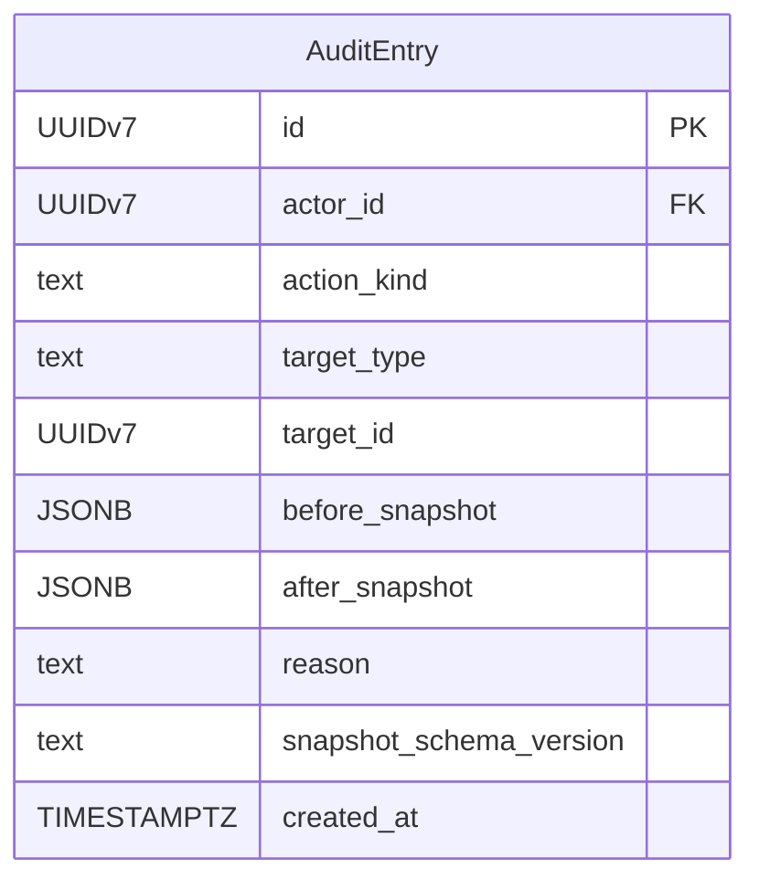

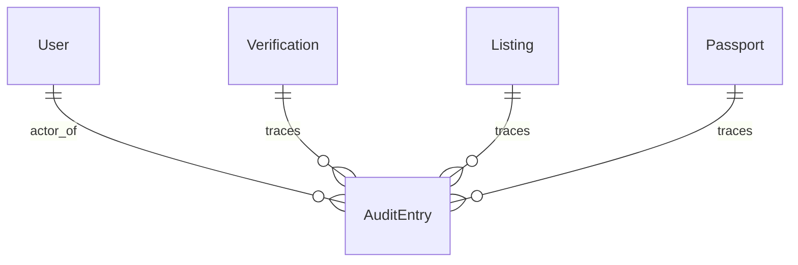

**Note on Django admin LogEntry.** The spine's AD-15 reserves Django admin's built-in `LogEntry` as the *complementary* stream for admin-side model edits (e.g. staff editing a User record directly in admin). It is not modeled here because it is a Django-built-in table; its existence is acknowledged but it is out of scope for the v1 ERD.

---

## Composite View (all 5 contexts together)

This is the architectural truth. Mirrors and extends the spine's Core-entity ERD at §Structural Seed:

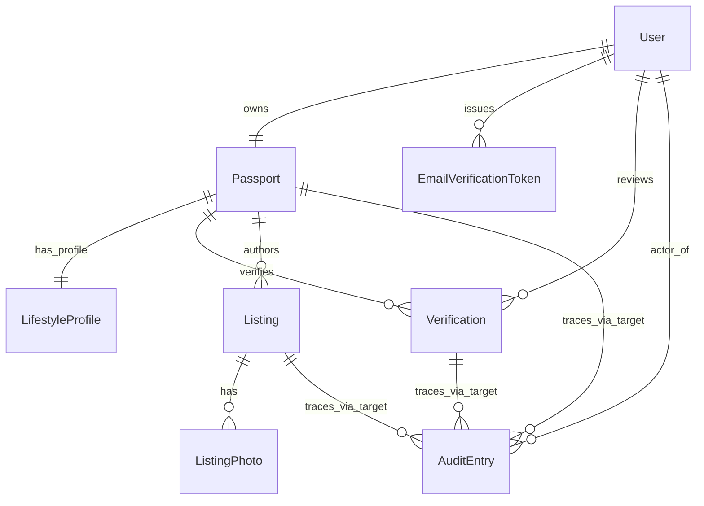

Differences from the spine's Core ERD:
1. **LifestyleProfile** added as 1:1 with Passport (was implicit in spine).
2. **EmailVerificationToken** added as a child of User (spine deferred to implementation).
3. **AuditEntry ↔ {Verification,Listing,Passport}** relationship described as `target_type` + `target_id` polymorphic reference (not hard FK), per AD-15's append-only + rename-safety rule. Cardinality and semantics are identical to the spine's `||--o{`. The three target kinds are: `verification.Verification` (state transitions), `listings.Listing` (CRUD + archive_stale), and `passports.Passport` (`display_name.change`).

---

## CASCADE vs RESTRICT — per-relationship rationale

The same `User.id` is referenced by tables with three different ON DELETE policies. This is **intentional** — it is not a modeling inconsistency. The two policies below are not interchangeable.

### ON DELETE CASCADE — dependents follow the user

| FK | Owner | Why CASCADE |
|---|---|---|
| `Passport.user_id → User.id` | Passport | A passport is the user's property; on account deletion the passport dies with it. There is no platform reason to keep a passport for a user who no longer exists. |
| `LifestyleProfile.passport_id → Passport.id` | LifestyleProfile | Lifestyle data is the passport's profile; follows the passport. |
| `Verification.passport_id → Passport.id` | Verification | A verification attempt is *of* a passport; follows the passport. |
| `EmailVerificationToken.user_id → User.id` | EmailVerificationToken | Tokens are short-lived (5-min expiry, single-use, ≤3 resends). They have no meaning once the account is gone, and retaining them risks an orphaned-but-still-valid hash being replayed if the same user id were ever re-issued. |
| `ListingPhoto.listing_id → Listing.id` | ListingPhoto | Photos are owned by the listing; if the listing is hard-removed, its media references are also removed. (v1 does not hard-delete listings; this is a defensive policy for migrations.) |

### ON DELETE RESTRICT — the user cannot be removed while dependents exist

| FK | Owner | Why RESTRICT |
|---|---|---|
| `Listing.author_id → Passport.id` | Listing | Listings are an operational signal; an admin or retention workflow should explicitly withdraw a passport's listings before deleting the user. RESTRICT surfaces this as a hard stop instead of silently orphaning or auto-archiving. |
| `Verification.reviewed_by_id → User.id` (SET NULL on actual FK) | Verification | Admin-staff rows point to the staff who decided. We use `SET NULL` (not `RESTRICT`) here so that staff off-boarding does not block verification history — the decision is preserved, the actor reference is anonymized. The audit trail (`AuditEntry.actor_id`) is the durable record. |
| `AuditEntry.actor_id → User.id` | AuditEntry | Audit rows must outlive their actor for compliance and for the post-staff-off-boarding query *"who did what?"*. RESTRICT forces the operator to either keep the actor row (soft-delete the user) or archive audit rows explicitly. |

**Summary rule:** *volatile / session-bound data cascades; durable state restricts*. Tokens and passport bundles cascade because they're meaningless without their user; listings, verification decisions, and audit rows restrict because they must outlive their owner.

---

## Explicitly absent in v1

These entities are **intentionally omitted**. Any of them showing up in an implementation PR is a scope violation until v2.

| Absent entity | Reason (PRD / Spine citation) |
|---|---|
| `Payment` | PRD §4.3 Non-goals — *"Not a payment or rent-collection platform"* |
| `Transaction` | Same as above |
| `Message` / `Conversation` | PRD §4.3 Non-goals — *"Not a chat platform"*; PRD §4.5 Out of Scope — *"In-app chat, first-reply messaging"* |
| `Match` | PRD Glossary — *"Match — Reserved for v2"*; spine `deferred_to_v2` includes FR-15 |
| `ContactShare` | PRD §4.5 — *"No in-app reply/message model or contact-share model exists in v1"* |
| `Report` / `ReportReason` | PRD §4.6 — *"v1 has no in-app report flow"*; spine `deferred_to_v2` includes FR-16/FR-17 |
| `Notification` | Spine AD-7 — *"There is no Notification table in v1"* |
| `LookingFor` (separate from Listing) | PRD §4.4 — *"v1 ships one Listing kind: Listing — no separate 'Looking For' demand-side post"* |
| `Block` / `Ban` / `Suspend` (rows) | PRD §4.6 — *"no admin-driven suspend/ban action"*; status is a `current_state` enum value, not a separate table |
| `Review` / `Rating` / `Star` | PRD §5 Non-goals — *"Not an algorithmic matching product"*; SM-2 measures post-match surveys, which are out-of-platform |
| `Favorite` / `Bookmark` | Not in PRD §4 in-scope; spine does not mention |
| `Device` / `Session` row | PRD §4.1 — *"Sessions persist for 30 days on the same device without re-auth"*; stock Django session backend is used (no domain model) |

---

## Open questions resolved by this diagram

| Question | Answer |
|---|---|
| Where does `state` live — Passport or Verification? | Verification is the legal state; Passport carries a `current_state` denormalization for read paths. |
| Is `LookingFor` a separate entity? | No. The PRD/spine collapsed it to a filtered view of Listing. |
| Does audit use FK constraints to target tables? | No. `target_type` + `target_id` polymorphic to keep audit append-only across renames (AD-15). |
| Where do lifestyle fields live? | On `LifestyleProfile`, not on Passport — keeps PII paths separate from lifestyle data and matches the spine's app boundary. |
| Where do NID/selfie photo paths live — Passport or Verification? | On `Verification` (one set per attempt). FR-3 requires fresh photos on every resubmission; storing on Passport would silently overwrite the prior attempt's images. |
| Is the admin's `reviewing` state visible to tenants? | No. `Verification.state` allows `'reviewing'`; `Passport.current_state` does not. The admin-claim transition flips only the Verification row and is not projected to the public read model. |

---

**End of ER diagram.**
