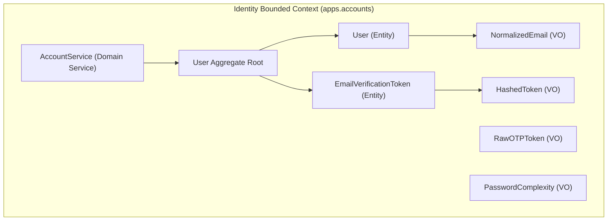

# Static Model - 001-account-identity-service

## Bounded Context

**Identity Context (`apps.accounts`)**: The kernel bounded context of Basha Pass responsible for account lifecycle, user authentication (tenants and admin staff), case-insensitive credential verification, 6-digit email OTP generation and verification, and session state management.

---

## Domain Entities

| Entity | Properties | Business Rules |
|--------|------------|----------------|
| `User` | `id` (UUID4 PK) `email` (`NormalizedEmail`, UK) `password_hash` (`str`) `display_name` (`str`, 2–32 chars) `email_verified` (`bool`, default False) `is_staff` (`bool`, default False) `is_active` (`bool`, default True) `date_joined` (`datetime`) `last_login` (`datetime`, optional) `created_at` (`datetime`) `updated_at` (`datetime`) | - `email` is globally unique and case-insensitive. - `display_name` is required (2–32 chars, regex `^[A-Za-z0-9 ._\-']+$`). - `email_verified` is False upon registration; must become True to create listings or access feeds. - `is_staff=True` grants access to stock Django admin; tenants have `is_staff=False`. - Passwords must never be stored in plain text. |
| `EmailVerificationToken` | `id` (UUID4 PK) `user_id` (FK → User.id) `token_hash` (`HashedToken`, 64 hex) `created_at` (`datetime`) `expires_at` (`datetime`) `consumed_at` (`datetime`, optional) `resend_count` (`int`, 0–3) | - Tokens are single-use (`consumed_at` prevents re-consumption). - Lifespan is strictly 5 minutes (`expires_at = created_at + 5 minutes`). - Raw token is never stored in DB (only SHA-256 hash). - Maximum 3 resend attempts allowed per signup attempt. |

---

## Value Objects

| Value Object | Properties | Constraints |
|--------------|------------|-------------|
| `NormalizedEmail` | `value: str` | RFC 5322 format, whitespace-stripped, converted to lowercase. |
| `RawOTPToken` | `value: str` | Exactly 6 numeric digits (`[0-9]{6}`), generated cryptographically via `secrets.randbelow(900000) + 100000`. |
| `HashedToken` | `value: str` | 64-character lowercase hex string computed via `hashlib.sha256(raw_otp.encode('utf-8')).hexdigest()`. |
| `PasswordComplexity` | `raw_value: str` | Minimum 8 characters, at least 1 uppercase letter (`[A-Z]`), at least 1 lowercase letter (`[a-z]`), at least 1 number (`[0-9]`), at least 1 special symbol (`[!@#$%^&*(),.?":{}|<>]`). |

---

## Aggregates

| Aggregate Root | Members | Invariants |
|----------------|---------|------------|
| `User` | `User` (root), `EmailVerificationToken` | 1. An unverified user may have at most ONE active unconsumed token at any instant. 2. Generating a new verification token automatically invalidates any existing unconsumed tokens for the user. 3. A token cannot be consumed if `now() > expires_at` or `consumed_at is not None`. 4. Consuming an active token atomically sets `token.consumed_at = now()` and `user.email_verified = True`. 5. `resend_count` is bounded: `0 <= resend_count <= 3`. Attempting a 4th resend is rejected. |

---

## Domain Events

| Event | Trigger | Payload |
|-------|---------|---------|
| `UserRegistered` | User submits valid signup details | `{user_id: UUID, email: str, display_name: str, created_at: datetime}` |
| `VerificationTokenIssued` | Initial signup or OTP resend | `{token_id: UUID, user_id: UUID, email: str, expires_at: datetime, resend_count: int}` |
| `EmailVerified` | User successfully enters matching 6-digit OTP | `{user_id: UUID, email: str, verified_at: datetime}` |
| `VerificationTokenExpired` | Validation attempted after 5 minutes | `{token_id: UUID, user_id: UUID, attempted_at: datetime}` |
| `VerificationResendExceeded` | User attempts 4th resend | `{user_id: UUID, attempts: int, timestamp: datetime}` |

---

## Domain Services

| Service | Operations | Dependencies |
|---------|------------|--------------|
| `AccountService` | - `register_user(email, password, display_name) -> tuple[User, RawOTPToken]` - `issue_verification_token(user) -> tuple[RawOTPToken, EmailVerificationToken]` - `verify_email_token(user, raw_token) -> ResultEnvelope` - `resend_verification_token(user) -> ResultEnvelope` - `validate_password_complexity(password) -> None` | `UserRepository`, `EmailVerificationTokenRepository`, `TransactionalEmailBackend` |

---

## Repository Interfaces

| Repository | Entity | Methods |
|------------|--------|---------|
| `UserRepository` | `User` | - `get_by_id(user_id: UUID) -> User | None` - `get_by_email(email: str) -> User | None` - `create_user(email: str, password: str, display_name: str) -> User` - `create_superuser(email: str, password: str) -> User` - `save(user: User) -> User` |
| `EmailVerificationTokenRepository` | `EmailVerificationToken` | - `get_latest_for_user(user: User) -> EmailVerificationToken | None` - `invalidate_unconsumed(user: User) -> int` - `create_token(user: User, token_hash: str, expires_at: datetime, resend_count: int) -> EmailVerificationToken` - `save(token: EmailVerificationToken) -> EmailVerificationToken` |

---

## Ubiquitous Language

| Term | Definition |
|------|------------|
| **Tenant** | Renter in Dhaka; the primary user category of Basha Pass in v1. |
| **Staff User** | Administrative team member with `is_staff=True` who reviews verification submissions. |
| **Email Verification Token** | Single-use 6-digit numeric OTP sent via email to confirm ownership of the account email. |
| **Active Token** | A verification token that has not expired (`now() < expires_at`) and has not been consumed (`consumed_at is None`). |
| **Consumed Token** | A token that was successfully verified and can never be used again. |
| **Resend Cap** | Limit of 3 token resends per signup attempt to protect against email bombing and OTP brute force. |
| **Password Complexity** | Strict 5-part rule set enforcing length and character class diversity. |
