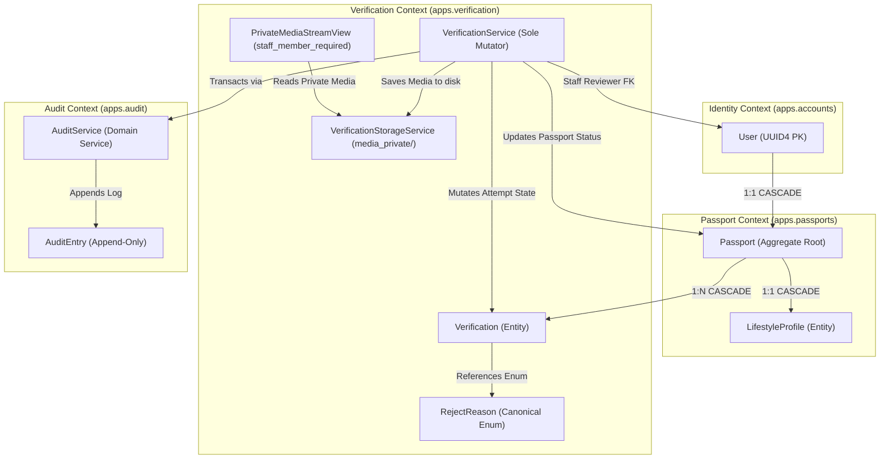

# Static Model: 001-passport-and-verification-domain

## Bounded Context

This unit spans three bounded contexts tailored for the Basha Pass MVP:

1. **Passport Context (`apps.passports`)**: Manages the `Passport` aggregate root and `LifestyleProfile` entity, enforcing tenant profile immutability once verified. *(Note: Complex ConsentService is deferred beyond MVP).*
2. **Verification Context (`apps.verification`)**: Manages `Verification` attempts, isolated private document storage under `media_private/` (AD-9), canonical rejection reason codes (AD-4), the `VerificationService` state machine (AD-2), and a staff-only authenticated media streaming endpoint for admin previews.
3. **Audit Context (`apps.audit`)**: Cross-cutting append-only compliance store (`AuditEntry`) recording all state mutations atomically (AD-15).

---

## Private PII Storage & Admin Media Preview Architecture

### How Private Media Works
1. **Isolated Storage**: Uploaded identity documents (front, back, selfie) are saved in `media_private/verifications/<passport_id>/` via `VerificationStorageService` using a private `FileSystemStorage(location=settings.MEDIA_PRIVATE_ROOT)`.
2. **Zero Public Access**: There is **no public URL** or static routing pointing to `media_private/`. Direct HTTP attempts cannot reach the directory.
3. **Staff-Only Streaming Endpoint**:
   - Route: `/admin/verification/media/<verification_id>/<doc_type>/` (where `doc_type` ∈ `{'nid_front', 'nid_back', 'selfie'}`).
   - Guarded by `@staff_member_required` / `user.is_staff=True`.
   - Unauthenticated visitors or non-staff tenants receive `403 Forbidden` or redirect to login.
   - For authorized staff, the view locates the file on disk and returns an authenticated `FileResponse(open(path, 'rb'), content_type=mime)`.
4. **Admin Panel Preview**: The Django Admin review view embeds `` tags pointing to this secure endpoint, allowing staff to view documents and thumbnails directly inside the admin panel.

---

## Domain Entities

| Entity | Properties | Business Rules |
|--------|------------|----------------|
| `Passport` | `id` (UUID4 PK) `user_id` (1:1 FK → `User.id`, CASCADE) `display_name` (`DisplayName`, 3–32 chars) `status` (`PassportStatus`: unverified, pending, verified, rejected) `created_at` (`datetime`) `updated_at` (`datetime`) | - Exactly one Passport per User. - `display_name` is unique across all passports, regex `^[A-Za-z0-9 ._\-']+$`. - **Immutability (FR-3)**: Once `status == 'verified'`, fields cannot be modified via UI or API. Changing verified details requires starting a fresh verification lifecycle. - Cascades on User deletion. |
| `LifestyleProfile` | `id` (UUID4 PK) `passport_id` (1:1 FK → `Passport.id`, CASCADE) `gender` (`GenderEnum`: male, female, other) `occupation` (`OccupationEnum`: student, garments_worker, private_job, freelancer, other) `smoking` (`SmokingEnum`: yes, no, occasionally) `sleep_schedule` (`SleepScheduleEnum`: early_bird, night_owl, flexible) `area_preference` (`list[DhakaSubArea]`) `budget_min` (`int`, BDT) `budget_max` (`int`, BDT) `created_at` (`datetime`) `updated_at` (`datetime`) | - 1:1 with Passport. - All 6 dimensions mandatory before verification submission. - `budget_min <= budget_max`, both bounded between ৳500 and ৳50,000. - `area_preference` contains 1 to 13 canonical Dhaka sub-areas. - Immutable once Passport is verified. |
| `Verification` | `id` (UUID4 PK) `passport_id` (FK → `Passport.id`, CASCADE) `state` (`VerificationState`: submitted, reviewing, verified, rejected) `nid_front_path` (`PrivateFilePath`) `nid_back_path` (`PrivateFilePath`) `selfie_path` (`PrivateFilePath`) `reject_reason` (`RejectReason` or NULL) `reviewer_notes` (`str` or NULL, max 500 chars) `submitted_at` (`datetime`) `last_rejection_at` (`datetime` or NULL) `reviewed_by_id` (FK → `User.id`, SET NULL, optional) `reviewed_at` (`datetime` or NULL) `created_at` (`datetime`) `updated_at` (`datetime`) | - Represents one verification attempt; every resubmission creates a fresh record (FR-3). - `nid_front_path`, `nid_back_path`, and `selfie_path` point exclusively to `media_private/` (AD-9). - `state` mutated solely via `VerificationService.transition(...)` (AD-2). - Rejection requires `reject_reason` from canonical enum (AD-4) and records `last_rejection_at = now()`. - Ordered FIFO by `submitted_at` in review queue (FR-7). |
| `AuditEntry` | `id` (UUID4 PK) `actor_id` (UUID4) `target_type` (`str`, e.g. `'verification.Verification'`) `target_id` (`UUID4`) `action` (`str`, e.g. `'transition'`) `before_state` (`dict`) `after_state` (`dict`) `reason_code` (`str` or NULL) `timestamp` (`datetime`) | - Append-only compliance log (AD-15). - Polymorphic reference without hard foreign keys to survive table renames. - Writes within same atomic database transaction as the state mutation. |

---

## Value Objects

| Value Object | Properties | Constraints |
|--------------|------------|-------------|
| `DisplayName` | `value: str` | 3 to 32 characters, regex `^[A-Za-z0-9 ._\-']+$`, stripped of leading/trailing whitespace. |
| `BudgetRange` | `min: int, max: int` | Integer BDT, `500 <= min <= max <= 50000`. |
| `DhakaSubArea` | `value: str` | Member of canonical 13 sub-areas: `Mirpur`, `Mohammadpur`, `Uttara`, `Banani`, `Gulshan`, `Baridhara`, `Bashundhara`, `Dhanmondi`, `Ramna`, `Tejgaon`, `Gazipur`, `Narayanganj-adjacent`, `Other`. |
| `RejectReason` | `value: str` | Member of 5 canonical enum values: `expired`, `mismatch`, `illegible`, `tampering_suspected`, `other` (AD-4). |
| `PrivateFilePath` | `path: str` | Relative path inside `media_private/`; valid image extension (`.jpg`, `.jpeg`, `.png`, `.webp`), ≤ 5 MB on disk, never served via public URL. |
| `VerificationState` | `value: str` | One of `submitted`, `reviewing`, `verified`, `rejected`. |
| `PassportStatus` | `value: str` | One of `unverified`, `pending`, `verified`, `rejected`. |

---

## Aggregates

| Aggregate Root | Members | Invariants |
|----------------|---------|------------|
| `Passport` | `Passport` (root), `LifestyleProfile` | 1. User has at most one Passport. 2. Passport fields and LifestyleProfile are strictly immutable once `status == 'verified'`. 3. A Passport cannot transition to `pending` without valid 6 lifestyle fields and display name. 4. Deleting a user cascades and removes the Passport bundle. |
| `Verification` | `Verification` (root) | 1. State transitions follow legal DAG: `submitted → reviewing → verified | rejected`. 2. Transition to `reviewing`, `verified`, or `rejected` is forbidden for non-staff actors (`is_staff=True` required). 3. A rejected verification imposes a 24-hour cooldown: `now() - last_rejection_at >= 24h` before a new verification attempt can be submitted (FR-9). 4. Each attempt requires newly uploaded photos (no photo reuse across verification attempts). 5. Rejection is illegal without selecting a member of `RejectReason`. |

---

## Domain Events

| Event | Trigger | Payload |
|-------|---------|---------|
| `PassportCreated` | Tenant creates initial passport draft | `{passport_id: UUID, user_id: UUID, display_name: str}` |
| `VerificationSubmitted` | Tenant uploads NID/selfie & submits for review | `{verification_id: UUID, passport_id: UUID, submitted_at: datetime}` |
| `VerificationReviewStarted` | Staff opens submission in review queue | `{verification_id: UUID, reviewer_id: UUID, timestamp: datetime}` |
| `VerificationApproved` | Staff approves submission | `{verification_id: UUID, passport_id: UUID, reviewer_id: UUID, verified_at: datetime}` |
| `VerificationRejected` | Staff rejects submission | `{verification_id: UUID, passport_id: UUID, reason: str, reviewer_id: UUID, cooldown_until: datetime}` |
| `VerificationEscalated` | Staff escalates submission for senior review | `{verification_id: UUID, reviewer_id: UUID, timestamp: datetime}` |

---

## Domain Services

| Service | Operations | Dependencies |
|---------|------------|--------------|
| `VerificationService` | - `transition(passport, new_state, *, actor, reason=None, notes=None) -> ResultEnvelope` - `check_cooldown(passport) -> CooldownResult` - `send_verification_email(user, decision, reason=None, notes=None) -> bool` | `VerificationRepository`, `PassportRepository`, `AuditService`, `TransactionalEmailBackend` |
| `AuditService` | - `append(actor, target, action, before_state, after_state, reason_code=None) -> AuditEntry` | `AuditRepository` (AD-15) |
| `VerificationStorageService` | - `save_private_file(file, subdir='verifications') -> str` - `get_private_file_path(relative_path) -> Path` - `validate_image(file) -> ResultEnvelope` | `FileSystemStorage` pointing to `settings.MEDIA_PRIVATE_ROOT` (AD-9) |

---

## Repository Interfaces

| Repository | Entity | Methods |
|------------|--------|---------|
| `PassportRepository` | `Passport` | - `get_by_id(passport_id: UUID) -> Passport | None` - `get_by_user_id(user_id: UUID) -> Passport | None` - `save(passport: Passport) -> Passport` |
| `VerificationRepository` | `Verification` | - `get_by_id(verification_id: UUID) -> Verification | None` - `get_latest_for_passport(passport: Passport) -> Verification | None` - `get_fifo_pending_queue() -> QuerySet[Verification]` - `save(verification: Verification) -> Verification` |
| `AuditRepository` | `AuditEntry` | - `append_entry(entry: AuditEntry) -> AuditEntry` - `filter_by_target(target_type: str, target_id: UUID) -> QuerySet[AuditEntry]` |

---

## Ubiquitous Language

| Term | Definition |
|------|------------|
| **Tenant Passport** | The verified credential owned by a tenant, carrying public display name and lifestyle preferences while shielding raw citizen PII. |
| **Verification Attempt** | A discrete submission containing NID front, back, and selfie photos submitted for human staff review. |
| **Private Media Storage** | An isolated file directory (`media_private/`) inaccessible via public URLs, protected by backend permissions (AD-9). |
| **Private Media Stream View** | A staff-only HTTP endpoint streaming private media via `FileResponse` for Django admin previews. |
| **Sole Mutator** | The architectural invariant (AD-2) dictating that `VerificationService.transition(...)` is the only code path permitted to alter verification states. |
| **Rejection Cooldown** | The mandatory 24-hour server-enforced waiting period (FR-9) following a rejection before a tenant can resubmit. |
| **Reject Reason Code** | One of 5 canonical enum values (`expired`, `mismatch`, `illegible`, `tampering_suspected`, `other`) required on every rejection (AD-4). |
| **Audit Entry** | Append-only record tracking who changed what state and when across verification workflows. |
