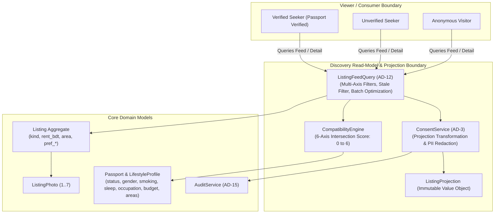

# Static Model: 001-listing-feed-query-and-consent

## Bounded Context

This unit operates as the **Discovery Read-Model & Privacy Projection Boundary** bridging three primary platform contexts:

1. **Listing Context (`apps.listings`)**: Source of supply-side rental inventory (`Listing` aggregate root and `ListingPhoto` entities).
2. **Passport Context (`apps.passports`)**: Source of verified seeker lifestyle preferences (`Passport` and `LifestyleProfile`) used for compatibility evaluation.
3. **Audit Context (`apps.audit`)**: Destination for compliance logging whenever a verified viewer reveals a lister's protected contact information (`contact_viewed`).

---

## Domain Entities & Projection Value Objects

### 1. Value Objects

| Value Object | Properties | Constraints & Business Invariants |
|---|---|---|
| `ViewerContext` | `user_id` (`UUID \| None`) `is_authenticated` (`bool`) `is_verified` (`bool`) `lifestyle_profile` (`SeekerLifestyleProfile \| None`) `is_staff` (`bool`) | Captures the viewer's identity and security attributes. If `is_authenticated=False` or `is_verified=False`, `is_verified` MUST be False. |
| `SeekerLifestyleProfile` | `gender` (`str`) `smoking` (`str`) `sleep_schedule` (`str`) `occupation` (`str`) `preferred_areas` (`list[str]`) `budget_bdt` (`int`) | Snapshot of the seeker's lifestyle parameters extracted from their verified passport for compatibility matching. |
| `PhotoProjection` | `id` (`UUID`) `photo_url` (`str`) `order` (`int`) | Lightweight read model of a listing photo with absolute/relative URL for rendering. |
| `ListingProjection` | `id` (`UUID`) `kind` (`str`) `kind_display` (`str`) `rent_bdt` (`int`) `rent_unit` (`str`) `rent_unit_display` (`str`) `area` (`str`) `body` (`str \| None`) `primary_photo_url` (`str \| None`) `photos` (`list[PhotoProjection]`) `author_id` (`UUID`) `author_display_name` (`str`) `author_tenure` (`str`) `author_is_verified` (`bool`) `author_lifestyle_summary` (`str \| None`) `lister_email` (`str \| None`) `lister_phone` (`str \| None`) `is_contact_locked` (`bool`) `compatibility_hint` (`int \| None`) `compatibility_matches` (`dict[str, bool] \| None`) `created_at` (`datetime`) `is_active` (`bool`) | **PII Non-Leakage Invariant (AD-3)**: If `viewer.is_verified == False`, `lister_email` and `lister_phone` MUST be `None`, `is_contact_locked` MUST be `True`, and `author_lifestyle_summary` MUST be `"Verify to see lifestyle fit"`. |
| `FeedFilterParams` | `areas` (`list[str]`) `budget_min` (`int \| None`) `budget_max` (`int \| None`) `kind` (`str \| None`) `rent_unit` (`str \| None`) `pref_gender` (`str \| None`) `pref_smoking` (`str \| None`) `pref_sleep` (`str \| None`) `pref_occupations` (`list[str]`) `sort` (`str`: `newest`, `rent_asc`, `rent_desc`) `page` (`int`, min 1) `page_size` (`int`, fixed 12) | Immutable container for search criteria. Enforces additive AND across filter categories and OR within multi-select categories. |

---

## Aggregates & Boundaries

This unit serves as a **Query/Projection Boundary**. It does not own persistent tables but reads from the `Listing` and `Passport` aggregates under the following invariants:

1. **Active Inventory Invariant (FR-1, FR-12)**: Public feed discovery strictly queries active listings:
   $$\text{Listing.is\_active} \iff \text{archived\_at IS NULL} \land \text{withdrawn\_at IS NULL} \land \text{created\_at} \ge (\text{now}() - 60\text{ days})$$
2. **Zero N+1 Query Invariant (AD-12)**: All feed queries MUST eager-load foreign keys (`select_related('author__user')`) and child collections (`prefetch_related('photos')`) so that database hits remain constant regardless of page size.
3. **Deterministic Compatibility Invariant (AD-12)**: The compatibility hint MUST be an integer $X \in [0, 6]$ calculated across the 6 canonical axes. Algorithmic re-ranking, weighted stars, and percentages are strictly forbidden.

---

## Domain Events

| Event | Trigger | Payload | Handling |
|---|---|---|---|
| `ContactRevealedEvent` | A verified viewer accesses a listing detail projection where `lister_email` and `lister_phone` are rendered. | `actor_id` (viewer User PK) `target_id` (Listing PK) `timestamp` `reason` (`'verified_viewer_reveal'`) | Handled by `AuditService.append()` to record an immutable `AuditEntry` (`action='contact_viewed'`). |

---

## Domain Services

### 1. `ConsentService` ([`AD-3`](file:///home/bs01496/Documents/LMS/basa-pass/docs/ARCHITECTURE-SPINE.md#L60-L75))
- **Role**: Sole owner of viewer-scoped data projection and privacy redaction.
- **Operations**:
  - `render_listing(viewer: ViewerContext, listing: Listing) -> ListingProjection`:
    - Checks `viewer.is_verified`.
    - If verified: includes `author.user.email` and `author.user.phone_number`; sets `is_contact_locked = False`.
    - If unverified/anonymous: redacts `email = None`, `phone = None`; sets `is_contact_locked = True`.
    - Strips all internal author identity data (national citizen ID, NID scans, selfies).

### 2. `CompatibilityEngine` ([`AD-12`](file:///home/bs01496/Documents/LMS/basa-pass/docs/ARCHITECTURE-SPINE.md#L173-L181))
- **Role**: Objective lifestyle comparison engine.
- **Operations**:
  - `evaluate(seeker: SeekerLifestyleProfile, listing: Listing) -> tuple[int, dict[str, bool]]`:
    - Axis 1 (Gender): `listing.pref_gender == 'any'` OR `listing.pref_gender == seeker.gender`
    - Axis 2 (Smoking): `listing.pref_smoking == 'any'` OR `listing.pref_smoking == seeker.smoking`
    - Axis 3 (Sleep): `listing.pref_sleep == 'flexible'` OR `listing.pref_sleep == seeker.sleep_schedule`
    - Axis 4 (Occupation): `'any' in listing.pref_occupation` OR `seeker.occupation in listing.pref_occupation`
    - Axis 5 (Area): `listing.area in seeker.preferred_areas`
    - Axis 6 (Budget): `listing.rent_bdt <= seeker.budget_bdt`
    - Returns `(score, match_breakdown_dict)`.

### 3. `ListingFeedQuery` ([`AD-12`](file:///home/bs01496/Documents/LMS/basa-pass/docs/ARCHITECTURE-SPINE.md#L173-L181))
- **Role**: Sole callable query engine for retrieving lists of listings across the application.
- **Operations**:
  - `for_viewer(viewer: ViewerContext, filters: FeedFilterParams) -> PaginatedProjections`:
    - Applies active and freshness constraints.
    - Applies multi-axis filters (`areas`, `budget`, `kind`, `unit`, `lifestyle`).
    - Applies selected sort (`newest`, `rent_asc`, `rent_desc`).
    - Paginates results to page size 12.
    - Maps each row through `ConsentService` and `CompatibilityEngine`.
  - `get_detail_for_viewer(viewer: ViewerContext, listing_id: UUID) -> ListingProjection | None`:
    - Retrieves listing by ID.
    - Runs projection and compatibility evaluation.
    - Emits `ContactRevealedEvent` if viewer is verified and contact details are projected.

---

## Repository / Data Access Interfaces

| Interface | Method | Description |
|---|---|---|
| `IListingReadRepository` | `get_active_feed_queryset(filters: FeedFilterParams) -> QuerySet[Listing]` | Builds optimized Django ORM queryset with eager loading and index hints. |
| `IListingReadRepository` | `get_by_id_with_photos(listing_id: UUID) -> Listing \| None` | Fetches single active listing with preloaded author and photo relation. |

---

## Ubiquitous Language

| Term | Definition |
|---|---|
| **`ListingFeedQuery`** | The sole architectural entrypoint returning lists of accommodation listings for any consumer surface ([`AD-12`](file:///home/bs01496/Documents/LMS/basa-pass/docs/ARCHITECTURE-SPINE.md#L173-L181)). |
| **`ConsentService`** | The sole authority on what viewer $X$ is permitted to see of listing $Y$ and author $Z$ ([`AD-3`](file:///home/bs01496/Documents/LMS/basa-pass/docs/ARCHITECTURE-SPINE.md#L60-L75)). |
| **`ListingProjection`** | An immutable, viewer-safe data container projected from internal domain entities. Templates consume projections, never raw models. |
| **`Soft-Gating`** | Platform pattern where public inventory is freely discoverable, but personal contact information (email/phone) is locked behind passport verification ([`PRD §4.5`](file:///home/bs01496/Documents/LMS/basa-pass/docs/prd.md#L289-L306)). |
| **`Compatibility Hint`** | A server-side integer score $X \in [0, 6]$ showing how many lifestyle axes align between seeker and lister ([`AD-12`](file:///home/bs01496/Documents/LMS/basa-pass/docs/ARCHITECTURE-SPINE.md#L173-L181)). |
| **`Stale Listing`** | A listing older than 60 days that is automatically excluded from public discovery feeds. |
