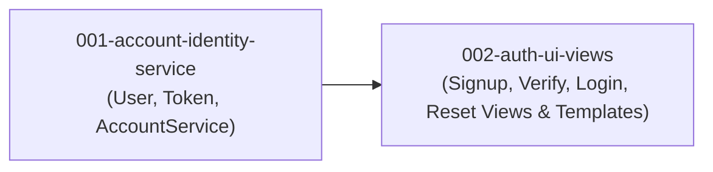

# Units: 002-user-authentication-and-registration

## Overview

The feature is decomposed into two distinct, independently testable units following Domain-Driven Design for the backend identity services and feature-based structure for user-facing auth views and templates.

## Units Summary

| Unit ID | Unit Name | Type | Assigned FRs | Bolt Type | Dependencies |
|---------|-----------|------|--------------|-----------|--------------|
| `001-account-identity-service` | Identity Domain & Account Service | backend | FR-1, FR-3, FR-4 (service), FR-7 (backend) | `ddd-construction-bolt` | None |
| `002-auth-ui-views` | Authentication UI & Presentation Views | frontend | FR-2, FR-4 (view), FR-5, FR-6, FR-7 (view), FR-8 | `simple-construction-bolt` | `001-account-identity-service` |

---

## Requirement-to-Unit Mapping

- **FR-1: Custom User Model & Accounts App Foundation** → `001-account-identity-service`
- **FR-2: Email-based Visitor Signup & Password Complexity** → `002-auth-ui-views`
- **FR-3: 6-Digit Email Verification Token Generation & Dispatch** → `001-account-identity-service`
- **FR-4: Token Verification & Account Activation Flow** → `001-account-identity-service` (logic) & `002-auth-ui-views` (view)
- **FR-5: User Login with Session Persistence (30 Days)** → `002-auth-ui-views`
- **FR-6: User Logout** → `002-auth-ui-views`
- **FR-7: Password Reset / Recovery Flow** → `001-account-identity-service` (backend) & `002-auth-ui-views` (views)
- **FR-8: Responsive Auth Templates & Design System Parity** → `002-auth-ui-views`

---

## Unit Dependency Graph

