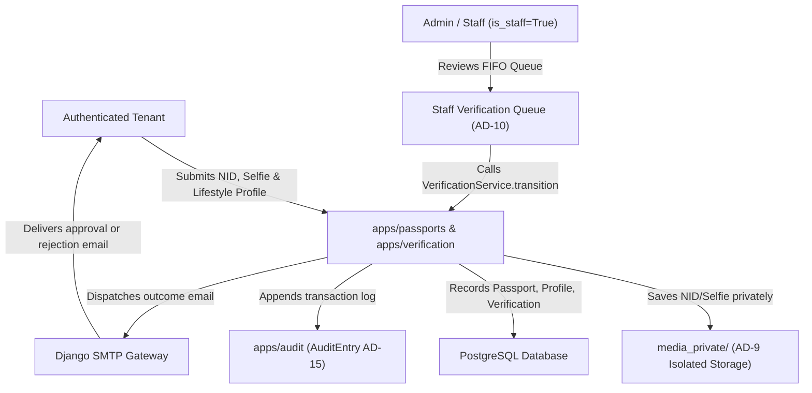

# 003-tenant-passport-and-verification - System Context

## System Overview

The Passport and Verification Contexts establish the trust foundation for Basha Pass. It enables authenticated tenants in Dhaka to create an immutable Tenant Passport with 6 lifestyle preferences, securely upload National ID (front and back) and selfie holding NID into private storage, and undergo manual staff verification. A strict state machine (`submitted` → `reviewing` → `verified` / `rejected`), 24-hour server-enforced rejection cooldown, direct email notifications, and an append-only audit trail guarantee high-trust rental interactions without exposing citizen PII to other tenants.

## Actors

- **Authenticated Tenant** (Human): A user with a verified email account who creates a Tenant Passport, configures lifestyle preferences, uploads NID front/back and selfie, and monitors verification status.
- **Admin / Verification Staff** (Human): An operator with `is_staff=True` who reviews FIFO queue submissions, inspects identity documents against the selfie, and approves or rejects submissions with mandatory reason codes.
- **Email Delivery Service** (External System): Outbound SMTP gateway delivering immediate verification outcome notifications (approval or rejection with reason code and cooldown timer).
- **Private Storage Subsystem** (Internal System): Dedicated filesystem storage under `media_private/` storing sensitive citizen identity documents isolated from public web access.

## Boundaries & External Systems

- **apps/accounts (Identity Kernel)**: Provides the authenticated `User` record to which `Passport` attaches via a 1:1 foreign key.
- **apps/passports (Passport Context)**: Houses `Passport` and `LifestyleProfile` models and `ConsentService` (governing viewer projections).
- **apps/verification (Verification Context)**: Houses `Verification` model, `VerificationService` (sole state machine mutator), canonical reject reasons enum, and private storage handler.
- **apps/audit (Audit Context)**: Cross-cutting append-only `AuditEntry` store recording all state mutations and decisions.
- **Browser Client**: Interacts with responsive multi-step wizard, document upload drag-and-drop, and dynamic 24-hour cooldown countdown timer.

## Data Flows

### Inbound
- **Passport Creation**: `display_name`, 6 lifestyle fields (`gender`, `occupation`, `smoking`, `sleep_schedule`, `area_preference`, `budget_min`, `budget_max`) via `POST /passports/create/`.
- **Identity Document Upload**: Multipart image files (`nid_front`, `nid_back`, `selfie`) via verification upload endpoint.
- **Admin Review Action**: Review decision (`approve`, `reject` with reason code + optional note, `escalate`) via staff queue endpoint.

### Outbound
- **Verification Decision Email**: Direct status notification sent within 5 minutes of review decision.
- **Audit Log Entry**: Transactional record in `AuditEntry` capturing actor, target, before/after states, reason code, and timestamp.
- **Status Projections**: HTMX partials and views rendering pending review alert or rejected countdown card (`21-dashboard-rejected.html`).

## Context Diagram

