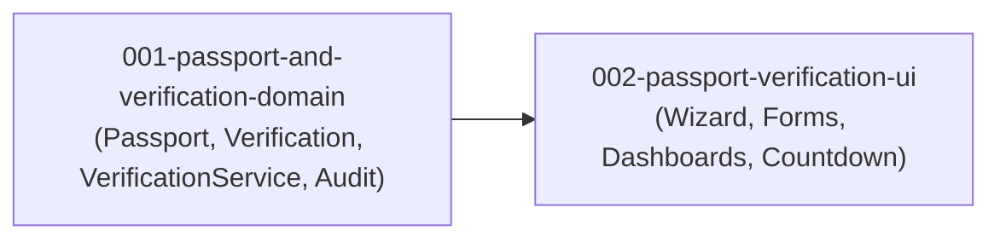

# Units: 003-tenant-passport-and-verification

## Overview

The feature is decomposed into two distinct, independently testable units following Domain-Driven Design for the backend identity and verification domain aggregates and feature-based structure for user-facing passport wizards and dashboards.

## Units Summary

| Unit ID | Unit Name | Type | Assigned FRs | Bolt Type | Dependencies |
|---------|-----------|------|--------------|-----------|--------------|
| `001-passport-and-verification-domain` | Passport & Verification Domain Services | backend | FR-1, FR-2, FR-3, FR-4, FR-5, FR-6, FR-7 | `ddd-construction-bolt` | `002-user-authentication-and-registration` |
| `002-passport-verification-ui` | Passport Wizard & Status Dashboards | frontend | FR-1 (form), FR-2 (upload), FR-5 (timer), FR-8 | `simple-construction-bolt` | `001-passport-and-verification-domain` |

---

### Unit 1: 001-passport-and-verification-domain

- **Description**: Core backend models, services, and admin review workflows for Tenant Passports and identity verification. Implements `Passport`, `LifestyleProfile`, `Verification`, and `AuditEntry` models; private media storage (`media_private/`); the `VerificationService` state machine with role enforcement; 24-hour rejection cooldown; direct email notifications; and the FIFO staff review queue.
- **Stories**:
  - `011-passport-and-lifestyle-models`
  - `012-verification-model-and-private-storage`
  - `013-verification-service-cooldown-and-audit`
  - `014-admin-verification-queue`
- **Deliverables**:
  - `apps/passports/models.py` (`Passport`, `LifestyleProfile`), `apps/passports/services/consent_service.py`
  - `apps/verification/models.py` (`Verification`), `apps/verification/services/reject_reasons.py`, `apps/verification/services/storage.py`
  - `apps/verification/services/verification_service.py`
  - `apps/audit/models.py` (`AuditEntry`), `apps/audit/services/audit_service.py`
  - `apps/verification/admin.py` (staff FIFO queue, review actions)
  - Unit and integration tests in `tests/test_passports/`, `tests/test_verification/`, `tests/test_audit/`
- **Dependencies**: Depends on `apps/accounts/models.py` (`User`).
- **Estimated Complexity**: L (High business logic, strict security invariants, state machine, private PII).

---

### Unit 2: 002-passport-verification-ui

- **Description**: User-facing presentation layer guiding tenants through passport creation, NID photo uploads, and status monitoring. Includes unverified teaser dashboard (`19`), multi-step submission wizard (`14`), in-review pending alert, dynamic 24-hour rejection countdown (`21`), and verified passport badge.
- **Stories**:
  - `015-passport-submission-wizard`
  - `016-verification-status-dashboards`
- **Deliverables**:
  - `apps/passports/forms.py` (`PassportForm`, `LifestyleProfileForm`, `VerificationUploadForm`)
  - `apps/passports/views.py` (`PassportWizardView`, `PassportDashboardView`)
  - `templates/passports/wizard/`, `templates/passports/dashboards/`
  - `static/css/passports.css`
  - View integration tests in `tests/test_passports/test_views.py`
- **Dependencies**: Depends on `001-passport-and-verification-domain`.
- **Estimated Complexity**: M (Multi-step form handling, file upload UX, countdown timer).

---

## Unit Dependency Graph

