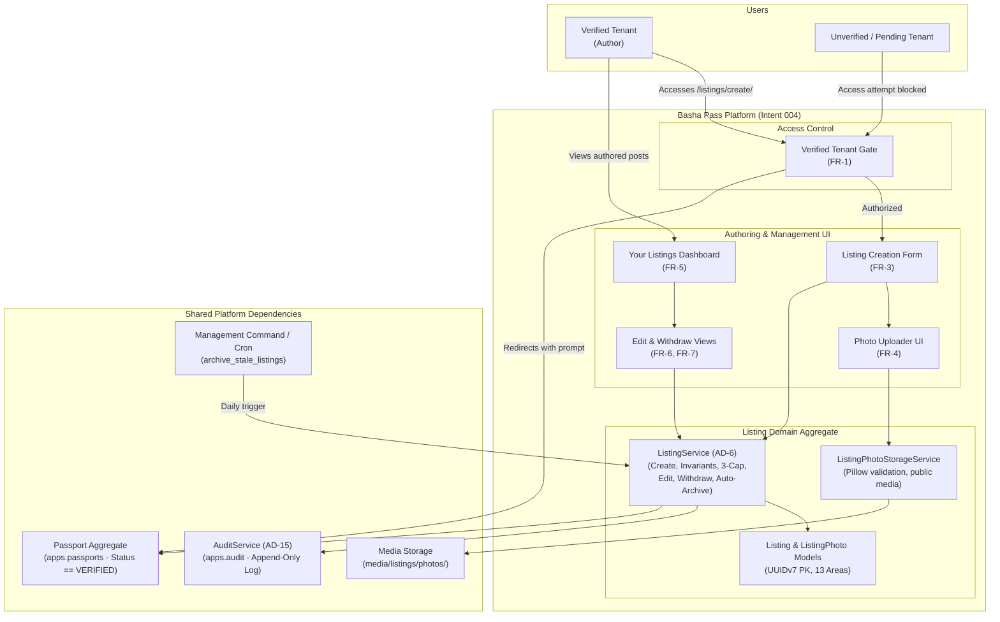

# 004-create-and-manage-listing - System Context

## System Overview

The **Listing Creation & Management** capability enables verified tenants in Dhaka to author, publish, update, and withdraw supply-side rental listings for available seats in a mess or private rooms. It serves as the primary supply engine for the Basha Pass marketplace, enforcing verified-only creation, cross-field integrity between accommodation kind and rent unit, a hard 3-active listing limit, and automatic archival.

## Context Diagram

## External & Cross-Context Integrations

- **Passport Context (`apps.passports`)**: Enforces pre-condition that author holds `passport.status == 'verified'`. Foreign key `author_id` references `Passport.id` (ON DELETE RESTRICT per ERD §4).
- **Audit Context (`apps.audit`)**: Captures immutable audit entries for all listing lifecycle mutations (create, edit, withdraw, and 60-day auto-archive).
- **Media Storage Engine**: Stores public listing photos under `media/listings/photos/<listing_id>/` at upload resolution after validating MIME type, file size (≤5MB), and magic bytes.
- **Django Management & Scheduling**: Custom command `archive_stale_listings` executes `ListingService.archive_stale()` periodically to auto-archive posts older than 60 days.

## High-Level Constraints

- **AD-6 ListingService Invariant Authority**: All mutations (`create`, `edit`, `withdraw`, `archive_stale`) must flow exclusively through `ListingService`. Direct ORM writes bypassing the service are strictly forbidden.
- **Mutual Consistency**: Accommodation `kind == 'seat'` requires `rent_unit == 'per_seat'`; `kind == 'room'` requires `rent_unit == 'per_room'`. `rent_period` is permanently fixed to `per_month`.
- **Anti-Spam 3-Active Limit**: A verified tenant can have at most 3 active (non-archived, non-withdrawn) listings at any given time.
- **Post-Publish Immutability**: Location `area` and accommodation `kind` cannot be altered once published. Only rent terms, body notes, and photos can be edited.

## Key NFR Goals

- **Execution Latency**: Form submission and service mutations complete in < 300ms.
- **Safety**: Robust file payload inspection (magic bytes / Pillow) rejecting corrupt or executable uploads.
- **Zero Public PII Leakage**: The authoring domain only captures listing descriptions and photos. Contact details are soft-gated on view surfaces (governed by `ConsentService` in feed intent).
