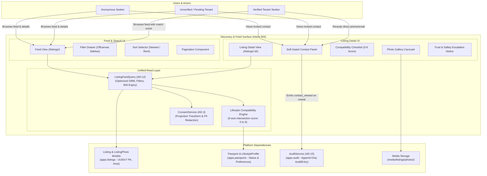

# 005-public-listing-feed-and-search - System Context

## System Overview

The **Public Listing Feed and Search Discovery** capability is the primary seeker-facing discovery surface for Basha Pass. It allows flat and mess seekers in Dhaka to browse active listings, filter across geographical (13 canonical sub-areas), financial (rent bounds), accommodation (seat vs room), and lifestyle dimensions, inspect detailed accommodation pages with photo galleries, view a transparent 6-axis lifestyle compatibility match hint (0–6 score), and access lister contact details through a soft-gated contact panel audited via immutable logs.

## Context Diagram

## External Integrations & Boundary Interfaces

- **`apps.listings` (Listing Aggregate Root)**: Provides the underlying active listing records, photos, and status invariants (`is_active`, `is_archived`, `is_withdrawn`).
- **`apps.passports` (Passport Context)**: Provides viewer lifestyle preferences (gender, smoking, sleep, occupation, preferred areas, budget) used by the compatibility engine.
- **`apps.audit` (Audit Context - AD-15)**: Records contact revelation events (`contact_viewed`) whenever a verified viewer views a lister's phone/email.

## High-Level Constraints

- **Unified Query Rule (AD-12)**: `ListingFeedQuery.for_viewer` is the single source of truth for listing feeds and search. No custom ORM queries in views or templates.
- **Strict DOM PII Shielding (AD-3)**: If a viewer is unverified or anonymous, lister email and phone must never be rendered into the HTML DOM.
- **No Algorithmic Black-Box**: Compatibility is strictly an integer count (0–6) of matching lifestyle axes. No algorithmic ranking or percentage scores.
- **Visual Design Parity**: Strict adherence to Mockup 03 (`03-listing-feed.html`) and Mockup 04 (`04-listing-detail.html`) brand tokens.

## Key NFR Goals

- Feed queries execute in < 150ms p95 on 10,000+ listings.
- Zero N+1 queries through eager `select_related` and `prefetch_related`.
- Full mobile responsiveness with offcanvas filter drawer and touch-friendly gallery.
