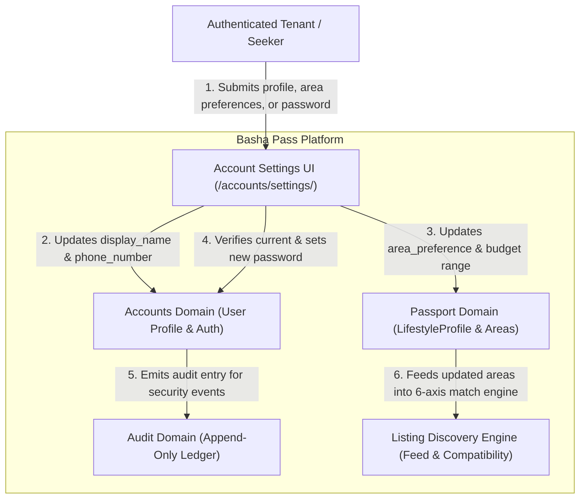

# Account Settings & Location Preferences — System Context

## System Overview

The Account Settings and Location Preferences capability enables authenticated Basha Pass tenants and flat seekers to self-manage personal profile attributes (display name, contact phone number), rotate passwords securely, and update their living search parameters (canonical Dhaka sub-areas, monthly budget min/max). Search parameters are decoupled from the strict NID verification lock, allowing living preferences to evolve freely while feeding dynamic 6-axis compatibility scores on public listings.

## Context Diagram

## External & Internal Boundaries

| Component | Responsibility | Boundary Type |
|-----------|----------------|---------------|
| `apps.accounts` | User identity, display name, contact phone, password validation & session auth hash update | Internal Core Domain |
| `apps.passports` | `Passport` and `LifestyleProfile` persistence, Dhaka sub-area validation (`DHAKA_SUB_AREAS`), budget bounds | Internal Domain |
| `apps.listings` | `ListingFeedQuery` read model & `CompatibilityEngine` evaluating seeker area alignment | Internal Consumer |
| `apps.audit` | Append-only `AuditEntry` ledger tracking security and profile updates | Internal Audit Boundary |

## High-Level Architectural Constraints

1. **Architecture Spine AD-3 (PII Shielding)**: Contact phone number updated in Account Settings is soft-gated by `ConsentService`; visible strictly to verified viewers.
2. **Owner-Scoped Mutability**: Settings updates strictly target `request.user` and `request.user.passport.lifestyle_profile`. Zero cross-tenant IDOR vulnerability.
3. **Decoupled Immutability Invariant**: Verified passport status protects immutable verification documents, but living search areas (`area_preference`) and search budgets (`budget_min`, `budget_max`) must be mutable without triggering validation errors or revoking verification.
4. **Session Integrity**: Password change executes `update_session_auth_hash(request, user)` so user session does not terminate unexpectedly.

## Key NFR Goals

- **Latency**: P95 server rendering < 120ms; transaction commit < 150ms.
- **Complexity**: Clean separation into backend domain services and frontend settings cards.
- **Audit Compliance**: All phone and password mutations logged to tamper-evident audit ledger.
