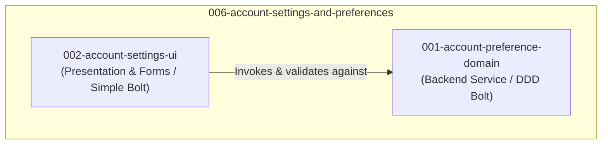

# Units Decomposition: 006-account-settings-and-preferences

## Overview

Following the `full-stack-web` architecture standard, Intent 006 is partitioned into two cohesive, independently testable units separating backend domain rules from frontend presentation and form interactions.

---

## Units Summary

| Unit | Type | Default Bolt Type | Priority | Description |
|------|------|-------------------|----------|-------------|
| `001-account-preference-domain` | Backend | `ddd-construction-bolt` | Must | Decouples `LifestyleProfile` search area mutability, provides profile & password change business logic, and emits audit entries. |
| `002-account-settings-ui` | Frontend | `simple-construction-bolt` | Must | Renders `/accounts/settings/` hub, profile form, location preference multi-select picker, security form, and navbar integration. |

---

## Unit 1: `001-account-preference-domain`

- **Purpose**: Encapsulate domain rules for account profile updates, location preference mutability on verified passports, password change validation, and audit recording.
- **Assigned Requirements**: FR-2, FR-3 (domain rules), FR-4 (domain rules), FR-5.
- **Key Files**:
  - `apps/passports/models.py` (`LifestyleProfile.clean` refinement)
  - `apps/accounts/services/account_service.py` (profile update, password update methods)
  - `apps/audit/services/audit_service.py` (security event logging)
- **Dependencies**: `apps.accounts`, `apps.passports`, `apps.audit`.

---

## Unit 2: `002-account-settings-ui`

- **Purpose**: Implement the user-facing Account Settings hub, form components, responsive template styling, and navigation hooks.
- **Assigned Requirements**: FR-1, FR-2 (UI), FR-3 (UI), FR-4 (UI).
- **Key Files**:
  - `apps/accounts/forms.py` (`ProfileSettingsForm`, `LocationPreferenceForm`, `PasswordChangeForm`)
  - `apps/accounts/views.py` (`AccountSettingsView`)
  - `apps/accounts/urls.py` (route `/settings/` or `/accounts/settings/`)
  - `templates/accounts/settings.html`
  - `templates/basha/partials/navbar.html` (Settings link in user dropdown)
  - `static/css/account-settings.css` (or `listings.css` brand tokens)
- **Dependencies**: `001-account-preference-domain`, `templates/base.html`.
